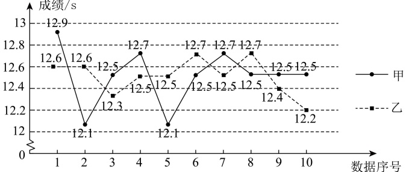

23. 校田径队教练选出甲、乙、丙、丁四名运动员参加100米比赛。对这四名运动员最近10次100米跑测试成绩（单位：s）的数据进行整理、描述和分析。下面给出了部分信息。

a. 甲、乙两名运动员10次测试成绩的折线图：

b. 丙运动员10次测试成绩：12.4 12.4 12.5 12.7 12.8 12.8 12.8 12.9 12.9

c. 四名运动员10次测试成绩的平均数、中位数、方差：

| | 甲 | 乙 | 丙 | 丁 |
| --- | --- | --- | --- | --- |
| 平均数 | 12.5 | 12.5 | $p$ | 12.5 |
| 中位数 | $m$ | 12.5 | 12.8 | 12.45 |
| 方差 | 0.056 | $n$ | 0.034 | 0.056 |

(1)表中 $m$ 的值为 ___ ；

(2)表中 $n$ ___ $0.056$（填"$>$""$=$"或"$<$"）；

(3)根据这10次测试成绩，教练按如下方式评估这四名运动员的实力强弱：首先比较平均数，平均数较小者实力更强；若平均数相等，则比较方差，方差较小者实力更强；若平均数、方差分别相等，则测试成绩小于平均数的次数较多者实力更强。

评估结果：这四名运动员按实力由强到弱依次为 ___ 。

> [!question]- 点击查看答案与解析
> 【答案】（1）$12.5$；（2）$>$；（3）丙、丁、甲、乙
> 
> 【考点】数据的集中趋势与波动 → [[【初中数学知识点体系-人教版】#24-1 数据的集中趋势]]
> 
> 【解析】
> （1）由折线图读取甲的10次成绩，排序后取中间两数的平均值，得 $m=12.5$。
>
（2）乙的成绩波动比甲大（由折线图观察），所以方差 $n>0.056$。
>
（3）四人平均数：甲=乙=丁=12.5，丙=p。比较方差：丙最小（0.034），甲=丁=0.056，乙最大。平均数相等时，方差小的更强。丙最强。甲和丁方差相同，需比较小于平均数的次数。由数据得丙>丁>甲>乙。
> 
> 【易错点】折线图数据读取不准确，或方差与波动程度的关系理解错误。
