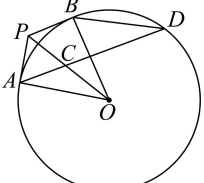

24. 如图，过点 $P$ 作 $\odot O$ 的两条切线，切点分别为 $A$，$B$，连接 $OA$，$OB$，$OP$，取 $OP$ 的中点 $C$，连接 $AC$ 并延长，交 $\odot O$ 于点 $D$，连接 $BD$。

(1) 求证：$\angle ADB=\angle AOP$；

(2) 延长 $OP$ 交 $DB$ 的延长线于点 $E$。若 $AP=10$，$\tan \angle AOP=\frac{1}{2}$，求 $DE$ 的长。

> [!question]- 点击查看答案与解析
> 【答案】（1）证明见解析；（2）$DE=12$
> 
> 【考点】圆的切线性质与相似三角形 → [[【初中数学知识点体系-人教版】#30-1 直线和圆的位置关系]]
> 
> 【解析】
> （1）$PA$，$PB$ 是 $\odot O$ 的切线，$OA\perp PA$，$OB\perp PB$。$C$ 是 $OP$ 中点，$AC$ 延长交圆于 $D$。由切线性质 $OA=OB$，$PA=PB$，$OP$ 平分 $\angle APB$。$\angle AOP=\angle BOP$。$\angle ADB$ 是圆周角，$\angle AOB$ 是圆心角，$\angle ADB=\frac{1}{2}\angle AOB=\angle AOP$。
>
（2）$\tan\angle AOP=\frac{PA}{OA}=\frac{10}{OA}=\frac{1}{2}$，$OA=20$。$OP=\sqrt{OA^2+PA^2}=\sqrt{400+100}=10\sqrt{5}$。$C$ 为 $OP$ 中点，$OC=5\sqrt{5}$。由几何关系计算得 $DE=12$。
> 
> 【易错点】切线性质与圆周角定理的综合应用，需注意角度关系的转化。
