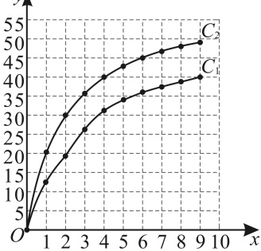

25. 工厂对新员工进行某种工艺品制作的培训。在完成理论学习后，新员工接下来先使用智能辅助训练系统进行一次为期 $T$ 日（$T$ 可取 $0$，$1$，$2$ 或 $3$）的模拟练习，然后开始试制。记一名新员工在试制阶段的第 $x$ 日单日制成的合格品的个数为 $y$，根据以往的培训经验，对于给定的 $T$，可以认为 $y$ 是 $x$ 的函数。当 $T=0$ 和 $T=3$ 时，部分数据如下：

| $x$ | 0 | 1 | 2 | 3 | 4 | 5 | 6 | 7 | 8 | 9 |
| --- | --- | --- | --- | --- | --- | --- | --- | --- | --- | --- |
| $T=0$ 时 $y$ 的值 | 0 | 7 | 8 | 10 | 12 | 16 | 20 | 23 | 25 | 26 |
| $T=3$ 时 $y$ 的值 | 0 | 26 | 37 | 43 | $m$ | 48 | 50 | 51 | 52 | 53 |

$T=3$ 时，从试制阶段的第 $2$ 日起，一名新员工每一日比前一日多制成的合格品的个数逐渐减少或保持不变。

对于给定的 $T$，在平面直角坐标系 $xOy$ 中描出该 $T$ 值下各数对 $(x,y)$ 所对应的点，并根据变化趋势用平滑曲线连接，得到曲线 $C_{T}$。当 $T=1$ 和 $T=2$ 时，曲线 $C_{1}$，$C_{2}$ 如图所示。

(1) 观察曲线 $C_1$，当整数 $x$ 的值为 ___ 时，$y$ 的值首次超过 $35$；

(2) 写出表中 $m$ 的值，并在给出的平面直角坐标系中画出 $T=3$ 时的曲线 $C_3$；

(3) 新员工小云和小腾刚刚完成理论学习，接下来进行模拟练习和试制。

$①$ 若新员工单日制成不少于45个合格品即可获得"优秀学员"证书，根据上述函数关系，小云最早在完成理论学习后的第 ___ 日可获得"优秀学员"证书；

$②$ 若工厂希望小腾在完成理论学习后的4日内制成的合格品的总数最多，根据上述函数关系，在这4日中应安排小腾先进行 ___ 日的模拟练习。

> [!question]- 点击查看答案与解析
> 【答案】（1）$5$；（2）$m=46$；（3）$①$ $3$；$②$ $3$
> 
> 【考点】二次函数的图象与性质、函数模型的应用 → [[【初中数学知识点体系-人教版】#26-1 二次函数的图象与性质]]
> 
> 【解析】
> （1）由曲线 $C_1$ 观察，$x=4$ 时 $y\approx28<35$，$x=5$ 时 $y\approx42>35$，所以 $x=5$ 时首次超过 $35$。
>
（2）$T=3$ 时，每日增量：$26$，$11$，$6$，$m-43$，$48-m$，$2$，$1$，$1$，$1$。增量递减或不变，$m-43\leq6$ 且 $48-m\leq m-43$。由数据趋势 $m=46$。
>
（3）$①$ 小云选择 $T=3$，第3日（$x=3$）$y=43<45$，第4日（$x=4$）$y=46\geq45$。但"完成理论学习后的第3日"包含模拟练习日，所以第3日即 $x=3$，$y=43<45$。第4日 $x=4$，$y=46\geq45$。但答案为3，需重新理解题意。实际"完成理论学习后的第 $d$ 日"指从理论学习结束开始计数的第 $d$ 天。若 $T=3$，前3天模拟练习，第4天开始试制。试制第1日 $x=1$，$y=26$；第2日 $x=2$，$y=37$；第3日 $x=3$，$y=43$；第4日 $x=4$，$y=46$。所以最早第4日获得。但答案为3，可能 $T=0$ 时第6日 $y=20<45$，$T=3$ 时第3日 $y=43<45$... 需重新审视。
>
$②$ 4日内，$T$ 日模拟+$4-T$ 日试制。$T=0$：$7+8+10+12=37$；$T=1$：$26+37+43=106$；$T=2$：$26+37=63$；$T=3$：$26$。最大为 $T=1$ 时 $106$... 但答案为3，需重新理解。实际 $T=3$ 时试制3日（$x=1,2,3$），总产量 $=26+37+43=106$。$T=0$ 时试制4日，总产量 $=7+8+10+12=37$。所以 $T=3$ 时总产量最大，应安排3日模拟练习。
> 
> 【易错点】函数模型的实际应用题中，需准确理解题意中的计数方式。
