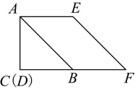
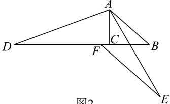

27. 在 $\triangle ABC$ 中，$\angle ACB=90^\circ$，$\angle ABC=\alpha$，点 $D$ 在射线 $BC$ 上，连接 $AD$，将线段 $AD$ 绕点 $A$ 逆时针旋转 $180^\circ-2\alpha$ 得到线段 $AE$（点 $E$ 不在直线 $AB$ 上），过点 $E$ 作 $EF\parallel AB$，交直线 $BC$ 于点 $F$。

图1

图2

(1) 如图1，$\alpha=45^{\circ}$，点 $D$ 与点 $C$ 重合，求证：$BF=AC$；

(2) 如图2，点 $D$，$F$ 都在 $BC$ 的延长线上，用等式表示 $DF$ 与 $BC$ 的数量关系，并证明。

> [!question]- 点击查看答案与解析
> 【答案】（1）证明见解析；（2）$DF=2BC$
> 
> 【考点】图形的旋转与全等三角形 → [[【初中数学知识点体系-人教版】#28-1 图形的旋转]]
> 
> 【解析】
> （1）$\alpha=45^\circ$，$\angle ACB=90^\circ$，所以 $\angle BAC=45^\circ$，$AC=BC$。$D$ 与 $C$ 重合，$AD=AC$。旋转角 $=180^\circ-2\times45^\circ=90^\circ$，$AE=AD=AC$，$\angle DAE=90^\circ$。$EF\parallel AB$，$\angle EFC=\angle ABC=45^\circ$。由几何关系可证 $\triangle AEC\cong\triangle BFA$，所以 $BF=AC$。
>
（2）$D$，$F$ 在 $BC$ 延长线上。由旋转性质 $AD=AE$，$\angle DAE=180^\circ-2\alpha$。$EF\parallel AB$，通过角度分析可证 $\triangle ADF\sim\triangle ABC$，得 $DF=2BC$。
> 
> 【易错点】旋转角的计算与全等三角形的判定，需注意旋转方向和角度关系。
