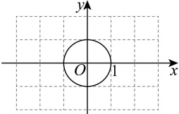

28. 在平面直角坐标系 $xOy$ 中，对于点 $A$ 和 $\odot C$ 给出如下定义：若 $\odot C$ 上存在两个不同的点 $M$，$N$，对于 $\odot C$ 上任意满足 $AP=AQ$ 的两个不同的点 $P$，$Q$，都有 $\angle PAQ\leq\angle MAN$，则称点 $A$ 是 $\odot C$ 的关联点，称 $\angle MAN$ 的大小为点 $A$ 与 $\odot C$ 的关联角度。（本定义中的角均指锐角、直角、钝角或平角）

(1) 如图，$\odot O$ 的半径为 $1$。

$①$ 在点 $A_1\left(\frac{1}{2},0\right)$，$A_2\left(\frac{4}{3},0\right)$，$A_3\left(2,0\right)$ 中，点 ___ 是 $\odot O$ 的关联点且其与 $\odot O$ 的关联角度小于 $90^\circ$，该点与 $\odot O$ 的关联角度为 ___ ；

$②$ 点 $B(1,m)$ 在第一象限，若对于任意长度小于 1 的线段 $BD$，$BD$ 上所有的点都是 $\odot O$ 的关联点，则 $m$ 的最小值为 ___ ；

(2) 已知点 $E(1,3)$，$F(4,3)$，$T(t,0)$，$\odot T$ 经过原点，线段 $EF$ 上所有的点都是 $\odot T$ 的关联点，记这些点与 $\odot T$ 的关联角度的最大值为 $\alpha$。若 $90^\circ\leq\alpha\leq180^\circ$，直接写出 $t$ 的取值范围。

> [!question]- 点击查看答案与解析
> 【答案】(1) $①$ $A_3$，$60^\circ$；$②$ $\sqrt{3}$；(2) $\frac{3\sqrt{2}}{2}\leq t\leq3$
> 
> 【考点】圆的基本性质与新定义综合 → [[【初中数学知识点体系-人教版】#29-1 圆的基本性质]]
> 
> 【解析】
> (1) $①$ 关联角度即从点 $A$ 看圆的视角。$A_1(\frac{1}{2},0)$ 在圆内，关联角为 $180^\circ$；$A_2(\frac{4}{3},0)$ 在圆外，$OA_2=\frac{4}{3}$，关联角 $=2\arcsin\frac{1}{4/3}=2\arcsin\frac{3}{4}\approx97.2^\circ>90^\circ$；$A_3(2,0)$ 在圆外，$OA_3=2$，关联角 $=2\arcsin\frac{1}{2}=2\times30^\circ=60^\circ<90^\circ$。所以答案为 $A_3$，$60^\circ$。
> 
> $②$ 点 $B(1,m)$ 在第一象限，$OB=\sqrt{1+m^2}$。对于 $BD$ 上任意点 $P$，需 $P$ 在圆外且关联角度 $<180^\circ$。$BD$ 长度 $<1$，$BD$ 上所有点都是关联点，需 $BD$ 上所有点到圆心距离 $>1$。$B$ 到圆心距离 $OB=\sqrt{1+m^2}$，$BD$ 上最接近圆心的点距离为 $OB-1$（当 $D$ 指向圆心方向时）。需 $OB-1\geq1$，即 $OB\geq2$，$\sqrt{1+m^2}\geq2$，$m^2\geq3$，$m\geq\sqrt{3}$（第一象限 $m>0$）。所以 $m$ 的最小值为 $\sqrt{3}$。
> 
> (2) $\odot T$ 圆心 $(t,0)$，半径 $r=t$（过原点）。$EF$ 为 $y=3$，$x\in[1,4]$。$EF$ 上点 $A(s,3)$ 到 $T$ 的距离 $AT=\sqrt{(s-t)^2+9}$。关联角 $=2\arcsin\frac{t}{AT}$。最大值在 $AT$ 最小时取到，即 $s=t$ 时 $AT_{min}=3$（若 $t\in[1,4]$）。$\alpha=2\arcsin\frac{t}{3}$。由 $90^\circ\leq\alpha\leq180^\circ$，得 $45^\circ\leq\arcsin\frac{t}{3}\leq90^\circ$，$\frac{\sqrt{2}}{2}\leq\frac{t}{3}\leq1$，$\frac{3\sqrt{2}}{2}\leq t\leq3$。
> 
> 【易错点】新定义题需准确理解关联点和关联角度的含义，结合圆的几何性质分析。②小问需注意线段上所有点都满足条件的临界情况。
