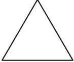
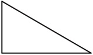
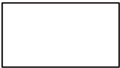
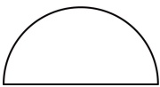

1. 下列图形中，是中心对称图形的是（）

A.

B.

C.

D.

> [!question]- 点击查看答案与解析
> 【答案】C
> 
> 【考点】中心对称图形 → [[【初中数学知识点体系-人教版】#28-2 中心对称]]
> 
> 【解析】
> 中心对称图形的定义：在平面内，把一个图形绕着某个点旋转 $180^{\circ}$，如果旋转后的图形能与原来的图形重合，那么这个图形叫做中心对称图形。
> 
> - 选项A：等边三角形，旋转 $180^{\circ}$ 后与原图不重合，不是中心对称图形；
> - 选项B：直角三角形，旋转 $180^{\circ}$ 后与原图不重合，不是中心对称图形；
> - 选项C：矩形（长方形），绕对角线交点旋转 $180^{\circ}$ 后与原图重合，是中心对称图形；
> - 选项D：半圆，旋转 $180^{\circ}$ 后开口向下，与原图不重合，不是中心对称图形。
> 
> 【易错点】混淆中心对称图形与轴对称图形；半圆是轴对称图形但不是中心对称图形。
