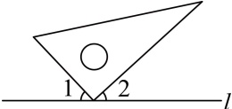

2. 如图，三角尺的直角顶点在直线 $l$ 上。若 $\angle1=48^{\circ}$，则 $\angle2$ 的大小为（）

A. $30^{\circ}$

B. $42^{\circ}$

C. $45^{\circ}$

D. $48^{\circ}$

> [!question]- 点击查看答案与解析
> 【答案】B
> 
> 【考点】余角与平角 → [[【初中数学知识点体系-人教版】#7-1 相交线]]
> 
> 【解析】
> 三角尺的直角顶点在直线 $l$ 上，因此 $\angle1$、直角和 $\angle2$ 组成一个平角（$180^{\circ}$）。
> 
> $\angle1 + 90^{\circ} + \angle2 = 180^{\circ}$
> 
> $\angle2 = 180^{\circ} - 90^{\circ} - \angle1 = 90^{\circ} - 48^{\circ} = 42^{\circ}$
> 
> 【易错点】误以为 $\angle1$ 和 $\angle2$ 互余而直接用 $90^{\circ}-48^{\circ}$，虽然结果相同但推理过程不同；应明确三个角组成平角。
