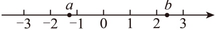

3. 实数 $a$，$b$ 在数轴上的对应点的位置如图所示，下列结论中正确的是（）

A. $a>b$

B. $-a>b$

C. $\left|a\right|=-a$

D. $ab>0$

> [!question]- 点击查看答案与解析
> 【答案】C
> 
> 【考点】实数与数轴 → [[【初中数学知识点体系-人教版】#8-3 实数及其简单运算]]
> 
> 【解析】
> 由数轴可知：$-1 < a < 0$，$2 < b < 3$。
> 
> - 选项A：$a < 0 < b$，所以 $a < b$，错误；
> - 选项B：由 $-1 < a < 0$ 得 $0 < -a < 1$，而 $b > 2$，所以 $-a < b$，错误；
> - 选项C：因为 $a < 0$，根据绝对值的性质，负数的绝对值等于它的相反数，即 $|a| = -a$，正确；
> - 选项D：$a < 0$，$b > 0$，异号相乘得负，$ab < 0$，错误。
> 
> 【易错点】由 $a$ 的位置判断 $-a$ 的范围时出错；忽略 $a$ 是负数这一关键信息。
