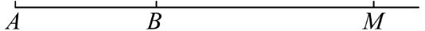

7. 如图，点 $B$ 在射线 $AM$ 上，在射线 $BM$ 上截取 $BC=BA$，分别以 $A$、$B$ 为圆心，$AB$ 长为半径画弧，两弧相交于点 $D$。连接 $BD$，$CD$，则 $\angle BDC$ 的大小为（）

A. $30^{\circ}$

B. $45^{\circ}$

C. $60^{\circ}$

D. $90^{\circ}$

> [!question]- 点击查看答案与解析
> 【答案】A
> 
> 【考点】等边三角形的判定与性质、等腰三角形 → [[【初中数学知识点体系-人教版】#13-3 三角形的内角与外角]]、[[【初中数学知识点体系-人教版】#15-3 等腰三角形]]
> 
> 【解析】
> 由作图可知：$AD = AB$，$BD = AB$，所以 $AB = AD = BD$。
> 
> 因此 $\triangle ABD$ 是等边三角形，$\angle ABD = 60^{\circ}$。
> 
> 因为点 $A$、$B$、$C$ 在同一直线上，所以 $\angle DBC = 180^{\circ} - \angle ABD = 180^{\circ} - 60^{\circ} = 120^{\circ}$。
> 
> 又因为 $BC = BA = BD$，所以 $\triangle BDC$ 是等腰三角形，$BD = BC$。
> 
> $\angle BDC = \angle BCD = \frac{180^{\circ} - 120^{\circ}}{2} = 30^{\circ}$。
> 
> 【易错点】忽略 $A$、$B$、$C$ 共线导致 $\angle DBC = 120^{\circ}$；误将 $\triangle BDC$ 当作等边三角形。
