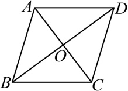

14. 如图，$\square ABCD$ 的两条对角线相交于点 $O$。已知 $\square ABCD$ 的面积为 $24$，$BD$ 的长为 $8$，当 $AO$ 的长为 ___ 时，$\square ABCD$ 是菱形。

> [!question]- 点击查看答案与解析
> 【答案】$3$
> 
> 【考点】菱形的判定与性质 → [[【初中数学知识点体系-人教版】#21-2 特殊的平行四边形]]
> 
> 【解析】
> 菱形的对角线互相垂直。当 $\square ABCD$ 是菱形时，$AC \perp BD$。
> 
> 对角线互相垂直的四边形面积等于对角线乘积的一半：
> 
> $S = \frac{1}{2} \times AC \times BD$
> 
> 代入已知条件：
> 
> $24 = \frac{1}{2} \times AC \times 8$
> 
> $24 = 4 \times AC$
> 
> $AC = 6$
> 
> 因为平行四边形对角线互相平分，所以 $AO = \frac{AC}{2} = \frac{6}{2} = 3$。
> 
> 【易错点】忘记菱形对角线互相垂直的性质；平行四边形面积公式与菱形面积公式混淆。
