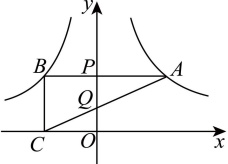

15. 如图，在平面直角坐标系 $xOy$ 中，过 $y$ 轴正半轴上的点 $P$ 作 $x$ 轴的平行线，分别交函数 $y=\frac{4}{x}(x>0)$ 和 $y=-\frac{3}{x}(x<0)$ 的图象于点 $A$、$B$，过点 $B$ 作 $x$ 轴的垂线，垂足为 $C$，连接 $AC$ 交 $y$ 轴于点 $Q$，则 $\frac{PQ}{OP}$ 的值为 ___ 。

> [!question]- 点击查看答案与解析
> 【答案】$\frac{4}{7}$
> 
> 【考点】反比例函数的综合应用 → [[【初中数学知识点体系-人教版】#27-1 反比例函数]]
> 
> 【解析】
> 设 $P(0, p)$（$p>0$）。
> 
> 因为 $AB \parallel x$ 轴，所以 $A$、$B$ 的纵坐标均为 $p$。
> 
> $A$ 在 $y=\frac{4}{x}$ 上：$p=\frac{4}{x} \Rightarrow x=\frac{4}{p}$，所以 $A\left(\frac{4}{p}, p\right)$。
> 
> $B$ 在 $y=-\frac{3}{x}$ 上：$p=-\frac{3}{x} \Rightarrow x=-\frac{3}{p}$，所以 $B\left(-\frac{3}{p}, p\right)$。
> 
> $C$ 是 $B$ 在 $x$ 轴上的垂足，所以 $C\left(-\frac{3}{p}, 0\right)$。
> 
> 直线 $AC$ 的斜率 $k = \frac{p-0}{\frac{4}{p}-(-\frac{3}{p})} = \frac{p}{\frac{7}{p}} = \frac{p^2}{7}$。
> 
> 直线 $AC$ 的方程：$y = \frac{p^2}{7}\left(x+\frac{3}{p}\right) = \frac{p^2}{7}x + \frac{3p}{7}$。
> 
> $Q$ 是 $AC$ 与 $y$ 轴的交点（$x=0$），所以 $Q\left(0, \frac{3p}{7}\right)$。
> 
> $PQ = p - \frac{3p}{7} = \frac{4p}{7}$，$OP = p$。
> 
> $\frac{PQ}{OP} = \frac{\frac{4p}{7}}{p} = \frac{4}{7}$。
> 
> 【易错点】设点坐标时遗漏参数 $p$；求直线方程时计算出错；混淆 $PQ$ 与 $OP$ 的长度。
