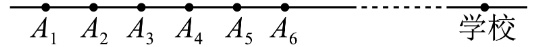

16. 如图所示，公路旁自西向东依次有 $A_{1}$，$A_{2}$，…，$A_{6}$ 共6处住宅和一所学校。每个工作日早上，每处住宅各有1名学生需乘同一辆校车前往该学校，校车仅在设于某一住宅处的车站停车一次，每名学生需从自家住宅沿公路步行至该车站乘车，6名学生都上车后，校车沿公路向东行驶至学校。

已知每名学生在相邻两处住宅间的步行时间均为2.5 min，校车在相邻两处住宅间的行驶时间均为1min，校车从 $A_{6}$ 处至学校的行驶时间为20 min。一名学生的理想通勤时间是指该学生从自家住宅至车站的步行时间与校车从车站至学校的行驶时间之和（不考虑其他因素）。

（1）若车站设在 $A_{2}$ 处，则住在 $A_{6}$ 处的学生的理想通勤时间为 ___ min；

（2）若当车站设在 $A_{k}$ 处时这6名学生的理想通勤时间之和最小，则 $k=$ ___ .

> [!question]- 点击查看答案与解析
> 【答案】（1）$34$；（2）$5$
> 
> 【考点】方案优化与最值问题 → [[【初中数学知识点体系-人教版】#12-1 统计调查]]
> 
> 【解析】
> **（1）车站设在 $A_2$ 处：**
> 
> 住在 $A_6$ 的学生步行到 $A_2$：经过 $A_5, A_4, A_3$，共 $4$ 段，步行时间 $= 4 \times 2.5 = 10$ min。
> 
> 校车从 $A_2$ 到学校：$A_2$ 到 $A_6$ 共 $4$ 段（$4 \times 1 = 4$ min），$A_6$ 到学校 $20$ min，行驶时间 $= 4 + 20 = 24$ min。
> 
> 理想通勤时间 $= 10 + 24 = 34$ min。
> 
> **（2）求通勤时间之和最小时的 $k$：**
> 
> 设车站在 $A_k$ 处。住在 $A_i$ 的学生：
> - 步行时间 $= |i-k| \times 2.5$ min
> - 校车行驶时间 $= (6-k) \times 1 + 20 = 26-k$ min（所有学生相同）
> 
> 6名学生通勤时间之和：
> 
> $S(k) = 2.5\sum_{i=1}^{6}|i-k| + 6(26-k)$
> 
> 分别计算：
> - $k=1$：$S=2.5\times15+150=187.5$
> - $k=2$：$S=2.5\times11+144=171.5$
> - $k=3$：$S=2.5\times9+138=160.5$
> - $k=4$：$S=2.5\times9+132=154.5$
> - $k=5$：$S=2.5\times11+126=153.5$
> - $k=6$：$S=2.5\times15+120=157.5$
> 
> 当 $k=5$ 时，$S$ 最小为 $153.5$ min。
> 
> 【易错点】校车行驶时间计算错误（忘记 $A_k$ 到 $A_6$ 的段数）；步行段数数错；未逐一计算比较。
