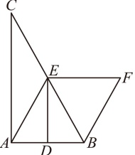

20. 如图，在 $\triangle ABC$ 中，$\angle CAB=90^{\circ}$，$D$，$E$ 分别为 $AB$，$BC$ 的中点，$BC=2BF$，$AE\parallel BF$。

(1) 求证：四边形 $ABFE$ 是平行四边形；

(2) 若 $AB=2$，$AC=3$，求四边形 $DBFE$ 的面积。

> [!question]- 点击查看答案与解析
> 【答案】（1）证明见解析；（2）$\frac{9}{4}$
> 
> 【考点】平行四边形的判定、三角形中位线 → [[【初中数学知识点体系-人教版】#21-1 平行四边形]]、[[【初中数学知识点体系-人教版】#13-2 与三角形有关的线段]]
> 
> 【解析】
> **（1）证明：**
> 
> 因为 $E$ 是 $BC$ 的中点，所以 $BC = 2BE$。
> 
> 又因为 $BC = 2BF$，所以 $BE = BF$。
> 
> 因为 $D$、$E$ 分别为 $AB$、$BC$ 的中点，所以 $DE$ 是 $\triangle ABC$ 的中位线，$DE \parallel AC$。
> 
> 因为 $\angle CAB = 90^{\circ}$，所以 $AC \perp AB$，从而 $DE \perp AB$。
> 
> 又 $AD = DB$，所以 $DE$ 是 $AB$ 的垂直平分线，$AE = BE$。
> 
> 由 $BE = BF$，得 $AE = BF$。
> 
> 又 $AE \parallel BF$，所以四边形 $ABFE$ 的一组对边平行且相等，故四边形 $ABFE$ 是平行四边形。
> 
> **（2）求四边形 $DBFE$ 的面积：**
> 
> $D$ 是 $AB$ 中点，$AB=2$，所以 $DB = 1$。
> 
> $DE$ 是中位线，$DE = \frac{1}{2}AC = \frac{3}{2}$，且 $DE \perp AB$。
> 
> $S_{\triangle DBE} = \frac{1}{2} \times DB \times DE = \frac{1}{2} \times 1 \times \frac{3}{2} = \frac{3}{4}$。
> 
> $E$ 是 $BC$ 中点，$S_{\triangle ABE} = \frac{1}{2}S_{\triangle ABC} = \frac{1}{2} \times \frac{1}{2} \times 2 \times 3 = \frac{3}{2}$。
> 
> 因为 $ABFE$ 是平行四边形，$BE$ 为对角线，所以 $S_{\triangle BEF} = S_{\triangle ABE} = \frac{3}{2}$。
> 
> $S_{DBFE} = S_{\triangle DBE} + S_{\triangle BEF} = \frac{3}{4} + \frac{3}{2} = \frac{9}{4}$。
> 
> 【易错点】中位线性质应用不熟练；平行四边形面积与三角形面积关系搞错；四边形DBFE的分割方式错误。
