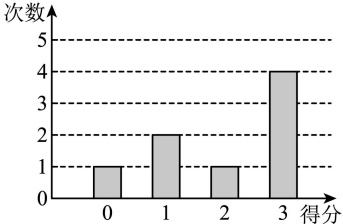
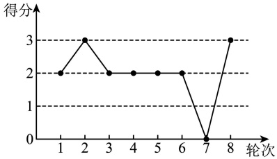

23. 若干名学生参加编程比赛，比赛共8轮，每轮有3道题，每人每轮的得分为该轮答对题目的数量（得分为整数）。已知甲、乙两名学生8轮得分的情况如下：

甲8轮得分的统计图

乙8轮得分的统计图

根据以上信息，回答下列问题：

(1) 甲8轮得分的平均数为 ___ ，乙8轮得分的平均数为 ___ ；

(2) 记甲、乙8轮得分的方差分别为 $s_{甲}^{2}$ 和 $s_{乙}^{2}$，则 $s_{甲}^{2}$ ___ $s_{乙}^{2}$（填"＞""＝"或"＜"）；

(3) 如果丙8轮得分的中位数为2.5，那么丙8轮得分的平均数是不是一定大于乙8轮得分的平均数？若是，请说明理由；若不是，请举出反例。

> [!question]- 点击查看答案与解析
> 【答案】（1）$2$，$2$；（2）$>$；（3）不一定，反例见解析
> 
> 【考点】平均数、方差、中位数 → [[【初中数学知识点体系-人教版】#24-1 数据的集中趋势]]、[[【初中数学知识点体系-人教版】#24-2 数据的波动]]
> 
> 【解析】
> **（1）平均数：**
> 
> 甲的得分：$0, 1, 1, 2, 3, 3, 3, 3$
> 
> $\bar{x}_甲 = \frac{0+1+1+2+3+3+3+3}{8} = \frac{16}{8} = 2$
> 
> 乙的得分：$2, 3, 2, 2, 2, 2, 0, 3$
> 
> $\bar{x}_乙 = \frac{2+3+2+2+2+2+0+3}{8} = \frac{16}{8} = 2$
> 
> **（2）方差比较：**
> 
> $s_甲^2 = \frac{(0-2)^2+(1-2)^2\times2+(2-2)^2+(3-2)^2\times4}{8} = \frac{4+2+0+4}{8} = \frac{10}{8} = 1.25$
> 
> $s_乙^2 = \frac{(2-2)^2\times5+(3-2)^2\times2+(0-2)^2}{8} = \frac{0+2+4}{8} = \frac{6}{8} = 0.75$
> 
> 所以 $s_甲^2 > s_乙^2$。
> 
> **（3）不一定大于。**
> 
> 反例：丙8轮得分为 $0, 0, 0, 2, 3, 3, 3, 3$。
> 
> 排序后中位数 $= \frac{2+3}{2} = 2.5$，满足条件。
> 
> 平均数 $= \frac{0+0+0+2+3+3+3+3}{8} = \frac{14}{8} = 1.75 < 2$。
> 
> 所以丙的平均数不一定大于乙的平均数。
> 
> 【易错点】从统计图中读取数据错误；方差公式记错；举反例时中位数计算错误。
