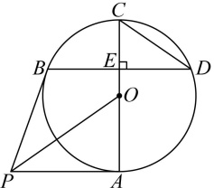

24. 如图，过点 $P$ 作 $\odot O$ 的两条切线，切点分别为 $A$，$B$，$AC$ 为 $\odot O$ 的直径，过点 $B$ 作 $AC$ 的垂线，垂足为 $E$，交 $\odot O$ 于点 $D$，连接 $OP$，$CD$。

(1) 求证：$\angle ACD=\angle POA$；

(2) 连接 $PC$ 交 $BD$ 于点 $F$，若 $CE=2$，$\tan\angle ACD=\sqrt{2}$，求 $BF$ 的长。

> [!question]- 点击查看答案与解析
> 【答案】（1）证明见解析；（2）$BF=\sqrt{2}$
> 
> 【考点】切线的性质、垂径定理、圆周角定理 → [[【初中数学知识点体系-人教版】#30-1 直线和圆的位置关系]]、[[【初中数学知识点体系-人教版】#29-1 圆的基本性质]]
> 
> 【解析】
> **（1）证明：**
> 
> 因为 $AC$ 是直径，$BD \perp AC$，由垂径定理，$AC$ 平分弧 $BD$，所以弧 $AB = $ 弧 $AD$。
> 
> $\angle ACD$ 是圆周角，所对的弧为 $AD$，所以 $\angle ACD = \frac{1}{2}\angle AOD$。
> 
> 因为弧 $AB = $ 弧 $AD$，所以 $\angle AOB = \angle AOD$，故 $\angle ACD = \frac{1}{2}\angle AOB$。
> 
> 因为 $PA$、$PB$ 是 $\odot O$ 的切线，所以 $PA=PB$，又 $OA=OB$，$OP$ 公共，$\triangle PAO \cong \triangle PBO$（SSS），所以 $\angle POA = \angle POB = \frac{1}{2}\angle AOB$。
> 
> 因此 $\angle ACD = \angle POA$。
> 
> **（2）求 $BF$ 的长：**
> 
> 在 $Rt\triangle CDE$ 中，$\tan\angle ACD = \frac{DE}{CE} = \sqrt{2}$，$CE=2$，所以 $DE = 2\sqrt{2}$。
> 
> 由垂径定理，$BE = DE = 2\sqrt{2}$。
> 
> 设半径为 $r$，则 $OE = r - 2$。在 $Rt\triangle ODE$ 中：
> 
> $r^2 = (2\sqrt{2})^2 + (r-2)^2 = 8 + r^2 - 4r + 4$
> 
> 解得 $r = 3$，所以 $OA=OC=3$，$OE=1$，$AE=4$。
> 
> 建立坐标系：$O(0,0)$，$A(0,-3)$，$C(0,3)$，$E(0,1)$，$B(-2\sqrt{2},1)$，$D(2\sqrt{2},1)$。
> 
> $PA$ 是切线，$PA \perp AC$，所以 $P$ 在直线 $y=-3$ 上。由 $PB \perp OB$ 求得 $P(-3\sqrt{2}, -3)$。
> 
> 直线 $PC$ 的方程：$y = \sqrt{2}x + 3$。
> 
> 与 $BD$（$y=1$）联立：$1 = \sqrt{2}x + 3 \Rightarrow x = -\sqrt{2}$，所以 $F(-\sqrt{2}, 1)$。
> 
> $BF = |-\sqrt{2} - (-2\sqrt{2})| = \sqrt{2}$。
> 
> 【易错点】垂径定理应用不熟练；切线性质（切线垂直于过切点的半径）遗漏；坐标系建立后求P点坐标时计算出错。
