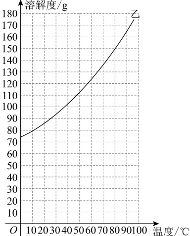

25. 在一定温度下，向一定量溶剂里加入某种溶质，当溶质不能继续溶解时，所得到的溶液叫作这种溶质的饱和溶液。固体的溶解度表示在一定温度下，某固态物质在100g溶剂里达到饱和状态时所溶解的质量。小云通过查阅资料，得到了溶剂为水时物质甲（硝酸钾）在不同温度下的溶解度数据和溶剂为水时物质乙（硝酸钠）的溶解度曲线，如下所示：

| 温度°C | 0 | 10 | 20 | 30 | 40 | 50 | 60 | 70 | 80 |
| --- | --- | --- | --- | --- | --- | --- | --- | --- | --- |
| 甲的溶解度g | 13.3 | 20.9 | 31.6 | 45.8 | 63.9 | 85.5 | 110 | 138 | 169 |

(1) 根据表中数据，在图中画出 $0^{\circ}$ C~$80^{\circ}$ C 范围内甲的溶解度曲线；

(2) 当温度为 ___ °C（精确到个位）时，甲和乙的溶解度相同，均为 $n$ g。在该温度下，将 $n$ g 乙加入 $100$ g 水中，充分搅拌使其全部溶解后，将温度降至 $10^{\circ}$ C，此时会有 ___ g（精确到个位）乙从水中析出；

(3) 当温度为 $10^{\circ}$ C 时，小云将 $100$ g 甲加入到装有 $100$ g 水的 1 号杯中，将 $100$ g 乙加入到装有 $100$ g 水的 2 号杯中，充分搅拌后，发现两种物质均不能全部溶解。为使两种物质均能全部溶解，小云考虑了以下两种方案：

方案一：将温度提升至 $T^{\circ}$ C，充分搅拌后使两种物质均能全部溶解；

方案二：保持温度不变，向 1 号杯中再加入 $m_1$ g 水，向 2 号杯中再加入 $m_2$ g 水，充分搅拌后使两种物质均能全部溶解。

$①$ 方案一中，$T$ 的最小值为 ___ （精确到个位）；

$②$ 方案二中，$m_{1}+m_{2}$ 的最小值为 ___ （精确到个位）。

> [!question]- 点击查看答案与解析
> 【答案】（1）画图略；（2）$73$，$67$；（3）$①$ $60$；$②$ $403$
> 
> 【考点】函数图象的应用、数据分析 → [[【初中数学知识点体系-人教版】#26-3 二次函数的应用]]
> 
> 【解析】
> **（2）求甲乙溶解度相同的温度及析出质量：**
> 
> 由数据：$70^{\circ}$C 时甲$=138$、乙$\approx142$（乙多4）；$80^{\circ}$C 时甲$=169$、乙$\approx158$（甲多11）。
> 
> 交点在 $70\sim80^{\circ}$C 之间，每度差距变化约 $-1.5$，需 $\frac{4}{1.5}\approx2.7$ 度，故温度约为 $73^{\circ}$C。
> 
> 此时溶解度 $n \approx 147$ g。
> 
> $10^{\circ}$C 时乙的溶解度约为 $80$ g，所以析出 $147 - 80 = 67$ g。
> 
> **（3）$①$ 方案一：**
> 
> 溶解 $100$ g 甲需要溶解度 $\geq 100$ g，甲在 $60^{\circ}$C 时为 $110$ g，满足；
> 
> 溶解 $100$ g 乙需要溶解度 $\geq 100$ g，乙在 $40^{\circ}$C 时已约 $105$ g，满足。
> 
> 取较大值，$T$ 的最小值为 $60$。
> 
> **$②$ 方案二：**
> 
> $10^{\circ}$C 时甲溶解度 $20.9$ g，溶解 $100$ g 甲需水 $\frac{100}{20.9}\times100 \approx 478.5$ g，需加 $m_1 \approx 478.5 - 100 = 378.5$ g；
> 
> 乙溶解度约 $80$ g，溶解 $100$ g 乙需水 $\frac{100}{80}\times100 = 125$ g，需加 $m_2 = 125 - 100 = 25$ g；
> 
> $m_1 + m_2 \approx 378.5 + 25 = 403.5 \approx 403$ g。
> 
> 【易错点】从溶解度曲线读取数据不准确；交点温度估算错误；方案二中计算需水量时忘记减去已有的100g水。
