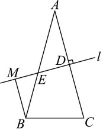
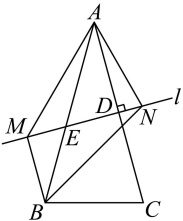

27. 在 $\triangle ABC$ 中，$AB=AC$，$\angle BAC=\alpha(0^\circ<\alpha<60^\circ)$，过 $AC$ 的中点 $D$ 作 $AC$ 的垂线 $l$，交 $AB$ 于点 $E$，点 $M$ 在 $DE$ 的延长线上，$\angle ABM=30^\circ$。

图1

图2

(1) 如图1，$\alpha=30^{\circ}$，求证：$AB=2DM$；

(2) 如图2，点 $N$ 在 $ED$ 的延长线上，$\angle ABN=30^{\circ}$，连接 $AM$，$AN$，直接写出 $\angle MAN$ 的大小，并证明。

> [!question]- 点击查看答案与解析
> 【答案】（1）证明见解析；（2）$\angle MAN = 60^{\circ}$
> 
> 【考点】等腰三角形、全等三角形、三角函数 → [[【初中数学知识点体系-人教版】#15-3 等腰三角形]]
> 
> 【解析】
> **（1）证明：**
> 
> 当 $\alpha=30^{\circ}$ 时，$AB=AC$，所以 $\angle ABC=\angle ACB=75^{\circ}$。
> 
> $D$ 是 $AC$ 中点，$l \perp AC$，所以 $l$ 是 $AC$ 的垂直平分线，$EA=EC$。
> 
> $\angle EAC=30^{\circ}$，故 $\angle ECA=30^{\circ}$，$\angle AEC=120^{\circ}$，$\angle BEC=60^{\circ}$。
> 
> $\angle ECB = \angle ACB - \angle ECA = 75^{\circ}-30^{\circ}=45^{\circ}$。
> 
> 在 $\triangle BEC$ 中，$\angle EBC=75^{\circ}$，$\angle ECB=45^{\circ}$，$\angle BEC=60^{\circ}$。
> 
> 在 $\triangle BEM$ 中，$\angle BEM=\angle AED=90^{\circ}-30^{\circ}=60^{\circ}$，$\angle EBM=30^{\circ}$，所以 $\angle BME=90^{\circ}$。
> 
> 设 $AB=AC=2a$，则 $AD=a$。在 $Rt\triangle ADE$ 中，$DE=a\tan30^{\circ}=\frac{\sqrt{3}}{3}a$，$AE=\frac{a}{\cos30^{\circ}}=\frac{2\sqrt{3}}{3}a$，$BE=2a-\frac{2\sqrt{3}}{3}a$。
> 
> 在 $Rt\triangle BEM$ 中，$EM=BE\cdot\sin30^{\circ}=\left(2a-\frac{2\sqrt{3}}{3}a\right)\cdot\frac{1}{2}=a-\frac{\sqrt{3}}{3}a$。
> 
> $DM=DE+EM=\frac{\sqrt{3}}{3}a+a-\frac{\sqrt{3}}{3}a=a$。
> 
> 所以 $AB=2a=2DM$。
> 
> **（2）$\angle MAN = 60^{\circ}$，证明如下：**
> 
> 设 $AB=AC=2a$，$AD=a$。在 $Rt\triangle ADM$ 和 $Rt\triangle ADN$ 中：
> 
> $\tan\angle MAD = \frac{DM}{AD} = \frac{\sqrt{3}\sin\alpha-\cos\alpha+2}{\sqrt{3}\cos\alpha+\sin\alpha}$
> 
> $\tan\angle NAD = \frac{DN}{AD} = \frac{2-\cos\alpha-\sqrt{3}\sin\alpha}{\sqrt{3}\cos\alpha-\sin\alpha}$
> 
> 计算得：
> 
> $\tan\angle MAD + \tan\angle NAD = \frac{2\sqrt{3}}{2\cos\alpha+1}$
> 
> $\tan\angle MAD \cdot \tan\angle NAD = \frac{2\cos\alpha-1}{2\cos\alpha+1}$
> 
> $\tan(\angle MAD+\angle NAD) = \frac{\tan\angle MAD+\tan\angle NAD}{1-\tan\angle MAD\cdot\tan\angle NAD} = \frac{\frac{2\sqrt{3}}{2\cos\alpha+1}}{\frac{2}{2\cos\alpha+1}} = \sqrt{3}$
> 
> 所以 $\angle MAD+\angle NAD = 60^{\circ}$，即 $\angle MAN = 60^{\circ}$。
> 
> 【易错点】垂直平分线性质遗漏；三角形内角和计算出错；三角函数化简过程中符号错误。
