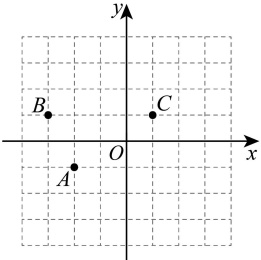
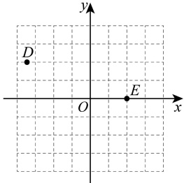

28. 对于不共线的三点 $A$，$B$，$C$，连接 $AB$，$AC$，并作劣弧 $\widehat{BC}$，使得 $\widehat{BC}$ 所在圆的圆心在过点 $A$ 且与 $BC$ 平行的直线上，称由 $AB$，$AC$ 和 $\widehat{BC}$ 组成的图形为单弧三角形，记作 $\triangle A-\widehat{BC}$，其中 $\widehat{BC}$ 所在圆的圆心称为 $\triangle A-\widehat{BC}$ 的弧心。在平面直角坐标系 $xOy$ 中，

图1

图2

(1) 如图1，点 $A(-2,-1)$，$B(-3,1)$，$C(1,1)$，直接写出 $\triangle A-\widehat{BC}$ 的弧心的坐标及 $\widehat{BC}$ 的长；

(2) 如图2，点 $D\left(-2\sqrt{3},2\right)$，$E(2,0)$，当 $\triangle D-\widehat{EF}$ 的弧心为 $O$ 时，求点 $F$ 的坐标；

(3) 已知点 $M(1,0)$，对于平面内的点 $N$，存在点 $P$，$Q$ 满足 $\triangle P-\widehat{MN}$ 和 $\triangle Q-\widehat{MN}$ 的弧心均为 $O$，$\triangle PMN$ 和 $\triangle QMN$ 都不是钝角三角形，且 $PQ=1$，记 $N$ 的横坐标为 $t$，直接写出 $t$ 的取值范围。

> [!question]- 点击查看答案与解析
> 【答案】（1）弧心 $(-1,-1)$，弧长 $\sqrt{2}\pi$；（2）$F(-1,\sqrt{3})$；（3）$-\frac{1}{4} \leq t \leq \frac{1}{2}$
> 
> 【考点】圆的基本性质、弧长计算、新定义 → [[【初中数学知识点体系-人教版】#29-1 圆的基本性质]]、[[【初中数学知识点体系-人教版】#30-3 弧长和扇形面积]]
> 
> 【解析】
> **（1）弧心坐标及弧长：**
> 
> $BC$ 是水平线（$y=1$），过 $A$ 且与 $BC$ 平行的直线为 $y=-1$。
> 
> 弧心在 $BC$ 的垂直平分线上，$BC$ 中点为 $(-1,1)$，垂直平分线为 $x=-1$。
> 
> 所以弧心为 $(-1,-1)$。
> 
> 半径 $r = \sqrt{(-1+3)^2+(-1-1)^2} = \sqrt{8} = 2\sqrt{2}$。
> 
> 弧心到 $B$、$C$ 的向量分别为 $(-2,2)$ 和 $(2,2)$，点积为 $0$，圆心角为 $90^{\circ} = \frac{\pi}{2}$。
> 
> 弧长 $= r \cdot \theta = 2\sqrt{2} \times \frac{\pi}{2} = \sqrt{2}\pi$。
> 
> **（2）求点 $F$ 的坐标：**
> 
> 弧心为 $O$，则 $EF \parallel OD$。$OD$ 的斜率为 $\frac{2}{-2\sqrt{3}} = -\frac{1}{\sqrt{3}}$。
> 
> $E(2,0)$，直线 $EF$ 的方程为 $y = -\frac{1}{\sqrt{3}}(x-2)$。
> 
> $F$ 在以 $O$ 为圆心、$OE=2$ 为半径的圆上：$x^2+y^2=4$。
> 
> 联立：$x^2 + \frac{(x-2)^2}{3} = 4 \Rightarrow 3x^2+(x-2)^2=12 \Rightarrow 4x^2-4x-8=0 \Rightarrow (x-2)(x+1)=0$。
> 
> $x=2$ 对应 $E$，所以 $x=-1$，$y = -\frac{1}{\sqrt{3}}(-3) = \sqrt{3}$。
> 
> 所以 $F(-1, \sqrt{3})$。
> 
> **（3）求 $t$ 的取值范围：**
> 
> 弧心为 $O$，则 $OM=ON=1$，$N$ 在单位圆上，$N(t, \pm\sqrt{1-t^2})$。
> 
> $P, Q$ 在过 $O$ 且平行于 $MN$ 的直线 $L$ 上。设 $L$ 上点的参数为 $k$，则 $P=k(t-1, s)$，$MN$ 长 $a=\sqrt{2(1-t)}$。
> 
> $\triangle PMN$ 不是钝角三角形的条件：
> - $\angle M \leq 90^{\circ} \Rightarrow k \geq -\frac{1}{2}$
> - $\angle N \leq 90^{\circ} \Rightarrow k \leq \frac{1}{2}$
> - $\angle P \leq 90^{\circ} \Rightarrow$ 当 $t<0$ 时，$k \leq -\sqrt{\frac{-t}{2(1-t)}}$ 或 $k \geq \sqrt{\frac{-t}{2(1-t)}}$；当 $t \geq 0$ 时恒成立。
> 
> 当 $t \geq 0$ 时，可行区间 $k \in [-\frac{1}{2}, \frac{1}{2}]$，长度为 $a=\sqrt{2(1-t)}$。需 $a \geq 1$，即 $t \leq \frac{1}{2}$。
> 
> 当 $t < 0$ 时，可行区间分为两段，$P, Q$ 可分属两段。两段最小间距为 $2\sqrt{-t}$，需 $2\sqrt{-t} \leq 1$，即 $t \geq -\frac{1}{4}$。
> 
> 综上，$t$ 的取值范围为 $-\frac{1}{4} \leq t \leq \frac{1}{2}$。
> 
> 【易错点】新定义理解错误；弧心位置的确定（在过A且平行于BC的直线上，同时在BC的垂直平分线上）；第(3)问中忽略P、Q可分属两个可行区间的情况。
