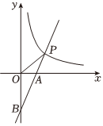

1. （2026•安徽）如图，在平面直角坐标系 $xOy$ 中，一次函数 $y=kx-1$（$k\neq 0$）的图象分别与 $x$ 轴和 $y$ 轴交于点 $A$ 和 $B$，与反比例函数 $y=\frac{m}{x}$（$m\neq 0$）在第一象限内的图象交于点 $P$．若 $OP=OB$，$\frac{PA}{AB}=\frac{3}{5}$，则 $m=$（　　）

A. $\frac{3}{4}$

B. $\frac{4}{3}$

C. $\frac{12}{25}$

D. $\frac{25}{12}$

> [!question]- 点击查看答案与解析
> 【答案】C
> 
> 【考点】反比例函数与一次函数的交点、待定系数法 → [[【初中数学知识点体系-人教版】#27-1 反比例函数]]、一次函数的图象与性质 → [[【初中数学知识点体系-人教版】#23-1 一次函数]]
> 
> 【解析】
> 直线 $y=kx-1$ 与 $y$ 轴交于 $B(0,-1)$，故 $OB=1$；由 $OP=OB$ 得 $OP=1$。
> 直线与 $x$ 轴交于 $A\left(\frac{1}{k},0\right)$。$P$ 在第一象限且位于 $A$ 的外侧，由 $\frac{PA}{AB}=\frac{3}{5}$，按分点关系 $P=A+\frac{3}{5}(A-B)$，得 $y_P=\frac{3}{5}$。
> 由 $OP=1$：$x_P^2+\left(\frac{3}{5}\right)^2=1$，第一象限取 $x_P=\frac{4}{5}$；又 $x_P=\frac{8}{5k}=\frac{4}{5}$，得 $k=2$。
> $P\left(\frac{4}{5},\frac{3}{5}\right)$ 在 $y=\frac{m}{x}$ 上，$m=x_P y_P=\frac{4}{5}\cdot\frac{3}{5}=\frac{12}{25}$。
> - 选项A：$\frac{3}{4}$，与计算结果不符，错误；
> - 选项B：$\frac{4}{3}$，与计算结果不符，错误；
> - 选项C：$\frac{12}{25}$，正确；
> - 选项D：$\frac{25}{12}$，与计算结果不符，错误。
> 
> 【易错点】注意分点方向：$P$ 在 $A$ 的外侧而非 $B$ 与 $A$ 之间；$OP=OB$ 中 $OB$ 是线段长度，取正值 1。
