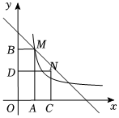

2. （2026•扬州）一次函数 $y=-x+b$（$b>0$）与反比例函数 $y=\frac{k}{x}$（$k>0$）的部分图象如图所示，$M$ 是它们的一个交点，$N$ 是它们所围成的区域（不含边界）内的一点．过点 $M$ 作 $MA\perp x$ 轴，$MB\perp y$ 轴，垂足分别为 $A$，$B$；过点 $N$ 作 $NC\perp x$ 轴，$ND\perp y$ 轴，垂足分别为 $C$，$D$．记矩形 $MAOB$ 的面积为 $S_{1}$，周长为 $C_{1}$，记矩形 $NCOD$ 的面积为 $S_{2}$，周长为 $C_{2}$，下列结论正确的是（　　）

A. $S_{1}<S_{2}$，$C_{1}<C_{2}$

B. $S_{1}<S_{2}$，$C_{1}>C_{2}$

C. $S_{1}>S_{2}$，$C_{1}<C_{2}$

D. $S_{1}>S_{2}$，$C_{1}>C_{2}$

> [!question]- 点击查看答案与解析
> 【答案】B
> 
> 【考点】反比例函数 $|k|$ 的几何意义、一次函数图象上点的坐标特征 → [[【初中数学知识点体系-人教版】#27-1 反比例函数]]、[[【初中数学知识点体系-人教版】#23-1 一次函数]]
> 
> 【解析】
> $M$ 在双曲线 $y=\frac{k}{x}$ 上，矩形 $MAOB$ 的面积 $S_1=k$。$N$ 在两曲线围成的区域内、位于双曲线上方，故 $x_N y_N>k$，即 $S_2>k=S_1$，所以 $S_1<S_2$。
> $M$ 在直线 $y=-x+b$ 上，$x_M+y_M=b$；$N$ 在直线下方，$x_N+y_N<b$。矩形周长 $C=2(x+y)$，故 $C_2<C_1$，即 $C_1>C_2$。
> - 选项A：$C_1<C_2$ 错误；
> - 选项B：$S_1<S_2$，$C_1>C_2$，正确；
> - 选项C、D：$S_1>S_2$ 错误。
> 
> 【易错点】周长大小不能由面积大小直接推出，须比较 $x+y$；区域位于双曲线上方时才有 $xy>k$。
