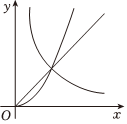

3. （2026•湖北） 已知点 $A(x_1, y_1)$ 在函数 $y=\frac{1}{x}$ 的图象上，点 $B(x_2, y_2)$ 在函数 $y=x^{2}$ 的图象上，点 $C(x_3, y_3)$ 在函数 $y=x$ 的图象上，$x_1$，$x_2$，$x_3$ 均大于 0．三个函数的图象位于第一象限的部分如图所示，当 $y_1=y_2=y_3$ 时，下列大小关系不可能的是（　　）

A. $x_1<x_2<x_3$

B. $x_1=x_2=x_3$

C. $x_3<x_2<x_1$

D. $x_3<x_1<x_2$

> [!question]- 点击查看答案与解析
> 【答案】D
> 
> 【考点】反比例函数、二次函数、正比例函数的图象与性质 → [[【初中数学知识点体系-人教版】#27-1 反比例函数]]、[[【初中数学知识点体系-人教版】#26-1 二次函数的图象与性质]]、[[【初中数学知识点体系-人教版】#23-1 一次函数]]
> 
> 【解析】
> 设三个函数相等的纵坐标为 $t>0$，则 $x_1=\frac{1}{t}$，$x_2=\sqrt{t}$，$x_3=t$。
> - 选项A：$x_1<x_2<x_3$，即 $\frac{1}{t}<\sqrt{t}<t$，当 $t>1$ 时成立，可能；
> - 选项B：$x_1=x_2=x_3$，当 $t=1$ 时三者均为 1，可能；
> - 选项C：$x_3<x_2<x_1$，即 $t<\sqrt{t}<\frac{1}{t}$，当 $0<t<1$ 时成立，可能；
> - 选项D：$x_3<x_1<x_2$，即 $t<\frac{1}{t}$ 要求 $t<1$，而 $\frac{1}{t}<\sqrt{t}$ 要求 $t>1$，两者矛盾，不可能。
> 
> 【易错点】跨函数比较应先用同一纵坐标 $t$ 把三个横坐标都表示出来，不能直接套用各函数的增减性。
