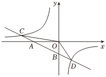

5. （2026•宿迁） 如图，直线 $y=kx+b$ 与坐标轴交于点 $A$ 和 $B(0, -2)$，与反比例函数 $y=-\frac{6}{x}$ 的图象交于点 $C$ 和 $D$，连接 $OC$、$OD$，若 $\frac{CA}{AB}=\frac{1}{2}$，则 $\triangle COD$ 的面积为（　　）

A. 6

B. 7

C. 8

D. 9

> [!question]- 点击查看答案与解析
> 【答案】C
> 
> 【考点】反比例函数与一次函数综合、坐标法求三角形面积 → [[【初中数学知识点体系-人教版】#27-1 反比例函数]]、[[【初中数学知识点体系-人教版】#23-1 一次函数]]、[[【初中数学知识点体系-人教版】#9-2 坐标方法的简单应用]]
> 
> 【解析】
> $B(0,-2)$，设直线 $y=kx-2$，与 $x$ 轴交于 $A\left(\frac{2}{k},0\right)$。$C$ 在第二象限，由 $\frac{CA}{AB}=\frac{1}{2}$，$A$ 分 $CB$ 成 $CA:AB=1:2$，故 $A=\frac{2C+B}{3}$。
> 由纵坐标 $0=\frac{2y_C-2}{3}$ 得 $y_C=1$；$C$ 在 $y=-\frac{6}{x}$ 上，$x_C=-6$，进而 $x_A=-4$，即 $A(-4,0)$。
> 直线过 $A$、$B$，解析式为 $y=-\frac{x}{2}-2$。联立 $-\frac{x}{2}-2=-\frac{6}{x}$，得 $x=-6$（点 $C$）或 $x=2$（点 $D$），$D(2,-3)$。
> $S_{\triangle COD}=\frac{1}{2}|x_C y_D-x_D y_C|=\frac{1}{2}|(-6)(-3)-2\times1|=8$。
> 
> 【易错点】注意分点比例的方向；坐标法求面积用行列式并取绝对值，不要漏掉 $\frac{1}{2}$。
