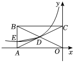

6. （2026•宁夏） 如图，在平面直角坐标系 $xOy$ 中，矩形 $OABC$ 的顶点 $A$，$C$ 分别在 $x$ 轴的负半轴与 $y$ 轴的正半轴上，对角线 $AC$ 与 $BO$ 相交于点 $D$．反比例函数 $y=\frac{k}{x}$（$k\neq 0$）的图象经过 $D$，并交 $AB$ 于点 $E$．已知 $B(-4, 2)$，则 $\triangle BDE$ 的面积是（　　）

A. $\frac{1}{2}$

B. $\frac{3}{2}$

C. 2

D. 3

> [!question]- 点击查看答案与解析
> 【答案】B
> 
> 【考点】反比例函数解析式、矩形中心与坐标法求面积 → [[【初中数学知识点体系-人教版】#27-1 反比例函数]]、[[【初中数学知识点体系-人教版】#9-2 坐标方法的简单应用]]
> 
> 【解析】
> 由 $B(-4,2)$ 得矩形顶点 $A(-4,0)$、$C(0,2)$；对角线 $AC$ 与 $BO$ 的交点 $D$ 为矩形中心，$D(-2,1)$。
> 双曲线过 $D$：$k=(-2)\times1=-2$。$E$ 在 $AB$（直线 $x=-4$）上，$y_E=\frac{-2}{-4}=\frac{1}{2}$，$E\left(-4,\frac{1}{2}\right)$。
> $BE=2-\frac{1}{2}=\frac{3}{2}$，$D$ 到直线 $x=-4$ 的水平距离为 $2$，故 $S_{\triangle BDE}=\frac{1}{2}\times\frac{3}{2}\times2=\frac{3}{2}$。
> 
> 【易错点】对角线交点是矩形的中心（顶点坐标的平均）；求面积时以竖边 $BE$ 为底、水平距离为高。
