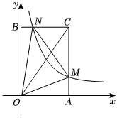

7. （2025•北京） 如图，在平面直角坐标系 $xOy$ 中，$A$，$B$ 分别是横、纵轴正半轴上的动点，四边形 $OACB$ 是矩形，函数 $y=\frac{1}{x}$（$x>0$）的图象与边 $AC$ 交于点 $M$，与边 $BC$ 交于点 $N$（$M$，$N$ 不重合）．给出下面四个结论：

$①$ $\triangle COM$ 与 $\triangle CON$ 的面积一定相等；

$②$ $\triangle MON$ 与 $\triangle MCN$ 的面积可能相等；

$③$ $\triangle MON$ 一定是锐角三角形；

$④$ $\triangle MON$ 可能是等边三角形．

上述结论中，所有正确结论的序号是（　　）

A. $①$ $③$

B. $①$ $④$

C. $②$ $③$

D. $②$ $④$

> [!question]- 点击查看答案与解析
> 【答案】B
> 
> 【考点】反比例函数上点的坐标特征、坐标法判断三角形面积与形状 → [[【初中数学知识点体系-人教版】#27-1 反比例函数]]、[[【初中数学知识点体系-人教版】#9-2 坐标方法的简单应用]]
> 
> 【解析】
> 设 $A(a,0)$、$B(0,b)$、$C(a,b)$，则 $M\left(a,\frac{1}{a}\right)$、$N\left(\frac{1}{b},b\right)$。
> $①$ $S_{\triangle COM}=\frac{1}{2}\cdot a\cdot\frac{1}{a}=\frac{1}{2}$，$S_{\triangle CON}=\frac{1}{2}\cdot\frac{1}{b}\cdot b=\frac{1}{2}$，两面积相等，正确。
> $②$ 令 $t=ab>1$，$S_{\triangle MON}=\frac{t^2-1}{2t}$，$S_{\triangle MCN}=\frac{(t-1)^2}{2t}$，相等仅当 $t=1$，此时 $M$、$N$ 重合，不成立，错误。
> $③$ 当矩形较高（$a$、$b$ 相应变化）时，$\angle M$ 或 $\angle N$ 可以为钝角，$\triangle MON$ 并非一定是锐角三角形，错误。
> $④$ 当 $uv=1$（$M$、$N$ 关于直线 $y=x$ 对称）且 $u^2+\frac{1}{u^2}=4$ 时，三边相等，可构成等边三角形，故等边三角形可能出现，正确。
> 综上，正确结论为 $①④$。
> 
> 【易错点】区分“一定成立”与“可能成立”；判断等边三角形需三边同时相等，并验证两点仍落在矩形边上。
