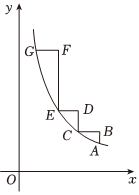

8. （2025•广西） 如图，在平面直角坐标系中，“双曲线阶梯”$ABCDEFG$ 的所有线段均与 $x$ 轴平行或垂直，且满足 $BC=DE=FG=1$，点 $A$，$C$，$E$，$G$ 均在双曲线 $y=\frac{k}{x}$ 的一支上．若点 $A$ 的坐标为 $(4, \frac{3}{2})$，则第三级阶梯的高 $EF=$（　　）

A. 4

B. 3

C. $\frac{7}{2}$

D. $\frac{5}{2}$

> [!question]- 点击查看答案与解析
> 【答案】B
> 
> 【考点】反比例函数上点的坐标特征与阶梯图形 → [[【初中数学知识点体系-人教版】#27-1 反比例函数]]
> 
> 【解析】
> 由 $A\left(4,\frac{3}{2}\right)$ 在 $y=\frac{k}{x}$ 上，$k=4\times\frac{3}{2}=6$。
> $BC=1$ 为水平线段，$x_C=4-1=3$，$y_C=\frac{6}{3}=2$，$C(3,2)$，故 $B(4,2)$。
> $DE=1$ 为水平线段，$x_E=3-1=2$，$y_E=\frac{6}{2}=3$，$E(2,3)$，故 $D(3,3)$。
> $FG=1$ 为水平线段，$x_G=2-1=1$，$y_G=\frac{6}{1}=6$，$G(1,6)$，故 $F(2,6)$。
> 竖直高度 $EF=6-3=3$。
> 
> 【易错点】阶梯横、竖交替：水平边长 1 用于推横坐标，竖直高由双曲线上两点的纵坐标差得到。
