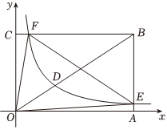

9. （2025•淄博） 如图，$D$ 为矩形 $OABC$（边 $OA$，$OC$ 分别在 $x$，$y$ 轴的正半轴上）对角线 $OB$ 上的点，且 $OD=\frac{1}{2}BD$．经过点 $D$ 的反比例函数 $y=\frac{k}{x}$ 的图象分别与 $AB$，$BC$ 相交于点 $E$，$F$，连接 $OE$，$OF$，$EF$．若 $\triangle OBF$ 的面积是 24，则 $\triangle OEF$ 的面积为（　　）

A. 25

B. 26

C. $\frac{79}{3}$

D. $\frac{80}{3}$

> [!question]- 点击查看答案与解析
> 【答案】D
> 
> 【考点】反比例函数解析式、线段比例与坐标法求面积 → [[【初中数学知识点体系-人教版】#27-1 反比例函数]]、[[【初中数学知识点体系-人教版】#9-2 坐标方法的简单应用]]
> 
> 【解析】
> 设 $B(a,b)$。由 $OD=\frac{1}{2}BD$ 得 $OD:DB=1:2$，$D\left(\frac{a}{3},\frac{b}{3}\right)$，故 $k=\frac{ab}{9}$。
> 双曲线与 $AB$ 交于 $E\left(a,\frac{b}{9}\right)$，与 $BC$ 交于 $F\left(\frac{a}{9},b\right)$。
> $S_{\triangle OBF}=\frac{1}{2}\left(a-\frac{a}{9}\right)b=\frac{4ab}{9}=24$，得 $ab=54$。
> $S_{\triangle OEF}=\frac{1}{2}\left|a\cdot b-\frac{a}{9}\cdot\frac{b}{9}\right|=\frac{40ab}{81}=\frac{80}{3}$。
> 
> 【易错点】$D$ 分对角线为 $1:2$ 时坐标是 $B$ 的 $\frac{1}{3}$；面积用行列式计算时不要漏掉系数。
