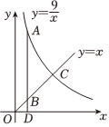

10. （2025•贵州） 如图，一次函数 $y=x$（$x\geq 0$）与反比例函数 $y=\frac{9}{x}$（$x>0$）的图象交于点 $C$，过反比例函数图象上点 $A$ 作 $x$ 轴垂线，垂足为点 $D$，交 $y=x$ 的图象于点 $B$，点 $A$ 的横坐标为1．有以下结论：

$①$ 线段 $AB$ 的长为8；

$②$ 点 $C$ 的坐标为 $(3, 3)$；

$③$ 当 $x>3$ 时，一次函数的值小于反比例函数的值．

其中结论正确的个数是（　　）

A. 0

B. 1

C. 2

D. 3

> [!question]- 点击查看答案与解析
> 【答案】C
> 
> 【考点】反比例函数与正比例函数的交点、图象上点的坐标特征 → [[【初中数学知识点体系-人教版】#27-1 反比例函数]]、[[【初中数学知识点体系-人教版】#23-1 一次函数]]
> 
> 【解析】
> $②$ 联立 $y=x$ 与 $y=\frac{9}{x}$：$x=\frac{9}{x}$，$x>0$ 得 $x=3$，$C(3,3)$，正确。
> $①$ $A$ 的横坐标为 1，$A(1,9)$；垂线 $x=1$ 交 $y=x$ 于 $B(1,1)$，$AB=9-1=8$，正确。
> $③$ 当 $x>3$ 时，$x>\frac{9}{x}$（如 $x=4$ 时 $4>\frac{9}{4}$），一次函数值大于反比例函数值，错误。
> 正确的是 $①②$，共 2 个。
> 
> 【易错点】比较函数值大小要看同一横坐标处两曲线的上下位置；垂足 $B$ 的纵坐标要用 $y=x$ 求，不能直接取双曲线值。
