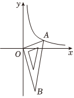

11. （2025•淮安） 在平面直角坐标系中，直角三角板 $AOB$ 按如图位置摆放，直角顶点与原点 $O$ 重合，点 $A$ 在反比例函数 $y=\frac{k}{x}$（$x>0$）的图象上，$\angle B=30^\circ$．若点 $B(1, -3)$，则 $k$ 的值是（　　）

A. -2

B. $\frac{1}{2}$

C. 1

D. 2

> [!question]- 点击查看答案与解析
> 【答案】C
> 
> 【考点】反比例函数解析式、两直线垂直与坐标变换 → [[【初中数学知识点体系-人教版】#27-1 反比例函数]]、[[【初中数学知识点体系-人教版】#9-2 坐标方法的简单应用]]
> 
> 【解析】
> $\angle AOB=90^\circ$，$\angle B=30^\circ$，故 $\frac{OA}{OB}=\tan30^\circ=\frac{1}{\sqrt{3}}$。
> 设 $A(x,y)$，由 $OA\perp OB$ 得 $\overrightarrow{OA}\cdot\overrightarrow{OB}=0$，即 $x-3y=0$，$x=3y$。
> $OA^2=10y^2$，$OB^2=10$，$\frac{OA^2}{OB^2}=\frac{1}{3}$，故 $y^2=\frac{1}{3}$；$A$ 在第一象限，$y=\frac{1}{\sqrt{3}}$，$x=\sqrt{3}$。
> $k=xy=\sqrt{3}\cdot\frac{1}{\sqrt{3}}=1$。
> 
> 【易错点】垂直条件用向量点积为 0；$30^\circ$ 角的对边是 $OA$；$A$ 在第一象限只取正根。
