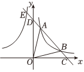

12. （2025•宿迁） 如图，点 $A$、$B$ 在双曲线 $y_1=\frac{k_1}{x}$（$x>0$）上，直线 $AB$ 分别与 $x$ 轴、$y$ 轴交于点 $C$、$D$，与双曲线 $y_2=\frac{k_2}{x}$（$x<0$）交于点 $E$，连接 $OA$、$OB$，若 $S_{\triangle AOC}=20$，$AB=3BC$，$AD=DE$，则 $k_2$ 的值为（　　）

A. -10

B. -11

C. -12

D. -13

> [!question]- 点击查看答案与解析
> 【答案】C
> 
> 【考点】反比例函数比例系数 $k$ 的几何意义、中点与线段比例 → [[【初中数学知识点体系-人教版】#27-1 反比例函数]]、[[【初中数学知识点体系-人教版】#9-2 坐标方法的简单应用]]
> 
> 【解析】
> 设 $A(x_A,y_A)$、$C(c,0)$。由 $AB=3BC$，$B$ 分 $AC$ 成 $AB:BC=3:1$，$B=\frac{A+3C}{4}$。
> $A$、$B$ 同在 $y_1=\frac{k_1}{x}$ 上，由 $x_B y_B=k_1$ 可推得 $c=5x_A$。
> $S_{\triangle AOC}=\frac{1}{2}\cdot 5x_A\cdot y_A=\frac{5}{2}k_1=20$，得 $k_1=8$。
> 直线过 $A$、$C$，其在 $y$ 轴截距 $d=\frac{5y_A}{4}$。由 $AD=DE$，$D$ 是 $AE$ 中点，$E=2D-A=\left(-x_A,2d-y_A\right)=\left(-x_A,\frac{3y_A}{2}\right)$。
> $k_2=x_E y_E=-\frac{3}{2}x_A y_A=-\frac{3}{2}k_1=-12$。
> 
> 【易错点】中点条件转化为 $E=2D-A$；第二象限双曲线 $k_2<0$；分点坐标的加权方向不要写反。
