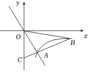

13. （2025•宜宾） 如图，$O$ 是坐标原点，反比例函数 $y=-\frac{4}{x}$（$x>0$）与直线 $y=-2x$ 交于点 $A$，点 $B$ 在 $y=-\frac{4}{x}$（$x>0$）的图象上，直线 $AB$ 与 $y$ 轴交于点 $C$，连结 $OB$，若 $AB=3AC$，则 $OB$ 的长为（　　）

A. $\sqrt{10}$

B. $\frac{5\sqrt{2}}{2}$

C. $\sqrt{34}$

D. $\frac{\sqrt{130}}{2}$

### 二、填空题（共18小题）

> [!question]- 点击查看答案与解析
> 【答案】D
> 
> 【考点】反比例函数与一次函数交点、线段比例与两点间距离 → [[【初中数学知识点体系-人教版】#27-1 反比例函数]]、[[【初中数学知识点体系-人教版】#9-2 坐标方法的简单应用]]
> 
> 【解析】
> 联立 $y=-2x$ 与 $y=-\frac{4}{x}$，得 $-2x=-\frac{4}{x}$，$x=\sqrt{2}$，$A(\sqrt{2},-2\sqrt{2})$。
> 由 $AB=3AC$，$A$ 分 $CB$ 成 $CA:AB=1:3$，$A=\frac{3C+B}{4}$。$C$ 在 $y$ 轴上，$x_C=0$，由横坐标 $\sqrt{2}=\frac{B_x}{4}$ 得 $B_x=4\sqrt{2}$。
> $B$ 在双曲线上，$B_y=-\frac{4}{4\sqrt{2}}=-\frac{\sqrt{2}}{2}$。
> $OB^2=(4\sqrt{2})^2+\left(\frac{\sqrt{2}}{2}\right)^2=32+\frac{1}{2}=\frac{65}{2}$，故 $OB=\frac{\sqrt{130}}{2}$。
> 
> 【易错点】先把长度比转化为分点坐标；$C$ 在 $y$ 轴上横坐标为 0；最后用距离公式开方，不要漏根号。
