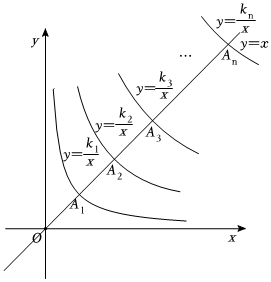

14. （2026•山东） 如图，一组反比例函数 $y=\frac{k_1}{x}$，$y=\frac{k_2}{x}$，$y=\frac{k_3}{x}$，…，$y=\frac{k_n}{x}$，其中 $x>0$，$k_{1}=1$，$k_{n}>k_{n-1}$，$n$ 为大于1的整数．这组反比例函数的图象与正比例函数 $y=x$ 的图象相交，交点依次记为 $A_{1}$，$A_{2}$，$A_{3}$，…，$A_{n}$．若 $A_1A_2=A_2A_3=\cdots=A_{n-1}A_n=\sqrt{2}$，则 $k_6=$ ___ ．

> [!question]- 点击查看答案与解析
> 【答案】$36$
> 
> 【考点】反比例函数与正比例函数的交点、坐标规律 → [[【初中数学知识点体系-人教版】#27-1 反比例函数]]
> 
> 【解析】
> 联立 $y=x$ 与 $y=\frac{k_i}{x}$，得 $x^2=k_i$，$A_i=(\sqrt{k_i},\sqrt{k_i})$。
> $A_iA_{i+1}=\sqrt{2}(\sqrt{k_{i+1}}-\sqrt{k_i})=\sqrt{2}$，故 $\sqrt{k_{i+1}}-\sqrt{k_i}=1$。
> $k_1=1$，$\sqrt{k_1}=1$，于是 $\sqrt{k_i}=i$，$k_i=i^2$，所以 $k_6=36$。
> 
> 【易错点】交点在 $y=x$ 上横、纵坐标相等；两点距离含 $\sqrt{2}$ 系数，不要漏掉。
