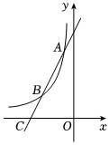

15. （2026•广东） 如图，直线 $y=2x+b$ 与反比例函数 $y=\frac{k}{x}$ 在第二象限的图象交于点 $A$，$B$，与 $x$ 轴交于点 $C$．点 $A$ 的横坐标为-1，且 $AB=2BC$，则反比例函数的解析式为 ___ ．

> [!question]- 点击查看答案与解析
> 【答案】$y=-\frac{6}{x}$
> 
> 【考点】反比例函数解析式、一次函数上的线段比例 → [[【初中数学知识点体系-人教版】#27-1 反比例函数]]、[[【初中数学知识点体系-人教版】#23-1 一次函数]]
> 
> 【解析】
> 点 $A$ 横坐标为 $-1$，$A(-1,b-2)$，故 $k=(-1)(b-2)=2-b$。
> 由 $AB=2BC$，$B$ 在 $C$、$A$ 之间，$CB:BA=1:2$，$B=\frac{2C+A}{3}$；$C\left(-\frac{b}{2},0\right)$，得 $B\left(\frac{-b-1}{3},\frac{b-2}{3}\right)$。
> 代入双曲线 $x_B y_B=k$，解得 $b=8$，$k=-6$，解析式为 $y=-\frac{6}{x}$。
> 
> 【易错点】分清 $B$ 分线段的内外与比例方向；第二象限的双曲线 $k<0$。
