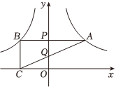

16. （2026•北京） 如图，在平面直角坐标系 $xOy$ 中，过 $y$ 轴正半轴上的点 $P$ 作 $x$ 轴的平行线，分别交函数 $y=\frac{4}{x}$（$x>0$）和 $y=-\frac{3}{x}$（$x<0$）的图象于点 $A$，$B$．过点 $B$ 作 $x$ 轴的垂线，垂足为 $C$，连接 $AC$ 交 $y$ 轴于点 $Q$，则 $\frac{PQ}{QO}$ 的值为 ___ ．

> [!question]- 点击查看答案与解析
> 【答案】$\frac{4}{3}$
> 
> 【考点】反比例函数上点的坐标、直线截距与线段比 → [[【初中数学知识点体系-人教版】#27-1 反比例函数]]、[[【初中数学知识点体系-人教版】#9-2 坐标方法的简单应用]]
> 
> 【解析】
> 设 $P(0,p)$。水平线 $y=p$ 与两曲线交于 $A\left(\frac{4}{p},p\right)$、$B\left(-\frac{3}{p},p\right)$，$C\left(-\frac{3}{p},0\right)$。
> 直线 $AC$ 斜率为 $\frac{p^2}{7}$，令 $x=0$ 得 $Q\left(0,\frac{3p}{7}\right)$。
> $PQ=p-\frac{3p}{7}=\frac{4p}{7}$，$QO=\frac{3p}{7}$，故 $\frac{PQ}{QO}=\frac{4}{3}$。
> 
> 【易错点】水平线上各点纵坐标相同；求 $y$ 轴截距时把 $x=0$ 代入直线方程。
