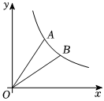

17. （2026•深圳） 如图，在平面直角坐标系中，点 $A(2, m)$，$B(3, n)$ 均在反比例函数 $y=\frac{k}{x}$（$k\neq 0$）的图象上，且 $OA=OB$，则 $k$ 的值为 ___ ．

> [!question]- 点击查看答案与解析
> 【答案】$6$
> 
> 【考点】反比例函数上点的坐标、两点间距离 → [[【初中数学知识点体系-人教版】#27-1 反比例函数]]、[[【初中数学知识点体系-人教版】#9-2 坐标方法的简单应用]]
> 
> 【解析】
> $m=\frac{k}{2}$，$n=\frac{k}{3}$。由 $OA=OB$：$4+m^2=9+n^2$，代入得 $k^2\left(\frac{1}{4}-\frac{1}{9}\right)=5$，$k^2=36$。
> 图象位于第一象限，$k>0$，故 $k=6$。
> 
> 【易错点】用距离平方列方程可避免开方；最后要由图象所在象限确定 $k$ 的符号。
