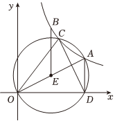

18. （2026•湖南） 如图，$A$，$B$，$C$ 是反比例函数 $y=\frac{k}{x}$（$k>0$，$x>0$）图象上三个不同的点，$AD\perp x$ 轴于点 $D$．
（1）若 $C$ 在 $\triangle OAD$ 的外接圆上，且 $A$ 点的坐标是 $(4, 2)$，则 $\tan\angle OCD=$ ___ ；
（2）设 $E$ 是线段 $OA$ 的中点，且 $BE\parallel y$ 轴．若 $BE=mAD$，则 $m=$ ___ ．

> [!question]- 点击查看答案与解析
> 【答案】（1）$2$；（2）$\frac{3}{2}$
> 
> 【考点】反比例函数、圆周角性质与坐标中点 → [[【初中数学知识点体系-人教版】#27-1 反比例函数]]、[[【初中数学知识点体系-人教版】#9-2 坐标方法的简单应用]]
> 
> 【解析】
> （1）$A(4,2)$，$k=8$。$\triangle OAD$ 中 $\angle D=90^\circ$，外接圆以 $OA$ 为直径。$\angle OCD$ 与 $\angle OAD$ 同对弦 $OD$，故相等。Rt$\triangle OAD$ 中 $OD=4$，$AD=2$，$\tan\angle OAD=\frac{OD}{AD}=2$，所以 $\tan\angle OCD=2$。
> （2）设 $A(x_A,y_A)$，$E$ 为 $OA$ 中点，$E\left(\frac{x_A}{2},\frac{y_A}{2}\right)$。$BE\parallel y$ 轴，$B$ 的横坐标为 $\frac{x_A}{2}$，代入双曲线得 $B\left(\frac{x_A}{2},2y_A\right)$。$BE=2y_A-\frac{y_A}{2}=\frac{3y_A}{2}$，$AD=y_A$，故 $m=\frac{BE}{AD}=\frac{3}{2}$。
> 
> 【易错点】同弧所对的圆周角相等；中点坐标代入双曲线时，纵坐标变为原来的 2 倍，不要算错倍数。
