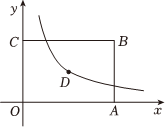

19. （2026•陕西） 如图，矩形 $OABC$ 的顶点 $A$，$C$ 分别在 $x$ 轴，$y$ 轴上，点 $B$ 在第一象限，反比例函数 $y=\frac{k}{x}$ 的图象经过矩形 $OABC$ 的对称中心 $D$．若矩形 $OABC$ 的面积为 12，则 $k$ 的值为 ___ ．

> [!question]- 点击查看答案与解析
> 【答案】$3$
> 
> 【考点】反比例函数 $|k|$ 的几何意义、矩形中心 → [[【初中数学知识点体系-人教版】#27-1 反比例函数]]
> 
> 【解析】
> 设 $B(a,b)$，矩形对称中心 $D\left(\frac{a}{2},\frac{b}{2}\right)$，$k=\frac{ab}{4}$。
> 矩形面积 $ab=12$，故 $k=3$。
> 
> 【易错点】对称中心是对角线中点；$k$ 是矩形面积的 $\frac{1}{4}$，不要直接取面积值。
