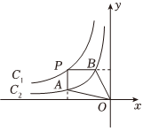

20. （2026•连云港） 如图，在平面直角坐标系 $xOy$ 中，两个反比例函数 $y=-\frac{6}{x}$ 和 $y=-\frac{2}{x}$ 在第二象限内的图象依次为 $C_{1}$，$C_{2}$．已知点 $P$ 在 $C_{1}$ 上，点 $A$，$B$ 在 $C_{2}$ 上，且 $PA\perp x$ 轴，$PB\perp y$ 轴，则四边形 $OAPB$ 的面积为 ___ ．

> [!question]- 点击查看答案与解析
> 【答案】$4$
> 
> 【考点】反比例函数 $|k|$ 的几何意义、面积割补 → [[【初中数学知识点体系-人教版】#27-1 反比例函数]]
> 
> 【解析】
> 设 $P(x,y)$，$xy=-6$。$PA\perp x$ 轴，$A\left(x,-\frac{2}{x}\right)$；$PB\perp y$ 轴，$B\left(-\frac{2}{y},y\right)$。
> 由割补法（或行列式），四边形 $OAPB$ 的面积为 $|k_1|-|k_2|=6-2=4$。
> 
> 【易错点】第二象限坐标带符号；该模型面积等于两双曲线 $|k|$ 之差。
