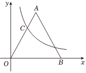

21. （2026•新疆） 如图，等边 $\triangle AOB$ 的面积为 $9\sqrt{3}$，边 $OA$ 与双曲线 $y=\frac{k}{x}$ 相交于点 $C$，且 $OA:OC=3:2$，则 $k=$ ___ ．

> [!question]- 点击查看答案与解析
> 【答案】$4\sqrt{3}$
> 
> 【考点】等边三角形面积、反比例函数上点的坐标 → [[【初中数学知识点体系-人教版】#27-1 反比例函数]]、[[【初中数学知识点体系-人教版】#9-2 坐标方法的简单应用]]
> 
> 【解析】
> 等边三角形面积 $\frac{\sqrt{3}}{4}\cdot OA^2=9\sqrt{3}$，得 $OA=6$。
> $OA:OC=3:2$，$OC=4$。$OA$ 与 $x$ 轴成 $60^\circ$，$C(4\cos60^\circ,4\sin60^\circ)=(2,2\sqrt{3})$，$k=xy=4\sqrt{3}$。
> 
> 【易错点】等边三角形顶点坐标用 $60^\circ$ 三角函数换算；第一象限 $k>0$。
