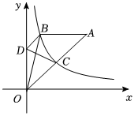

22. （2026•广元） 如图，在 $\triangle AOB$ 中，$AB\parallel x$ 轴，点 $C$ 为 $OA$ 的中点，函数 $y=\frac{k}{x}(x>0)$ 的图象经过 $B$，$C$ 两点，过点 $B$ 作 $OA$ 的平行线交 $y$ 轴于点 $D$，连接 $CD$，若 $\triangle COD$ 的面积为2，则 $k$ 的值为 ___ ．

> [!question]- 点击查看答案与解析
> 【答案】$\frac{8}{3}$
> 
> 【考点】反比例函数、中点与平行线坐标关系 → [[【初中数学知识点体系-人教版】#27-1 反比例函数]]、[[【初中数学知识点体系-人教版】#9-2 坐标方法的简单应用]]
> 
> 【解析】
> 设 $A(2a,2b)$，则中点 $C(a,b)$。$AB\parallel x$ 轴，$B$ 在双曲线上，得 $B\left(\frac{a}{2},2b\right)$。
> $BD\parallel OA$，斜率为 $\frac{b}{a}$，交 $y$ 轴于 $D\left(0,\frac{3b}{2}\right)$。
> $S_{\triangle COD}=\frac{1}{2}\cdot\frac{3b}{2}\cdot a=\frac{3ab}{4}=2$，故 $k=ab=\frac{8}{3}$。
> 
> 【易错点】中点坐标不要漏除以 2；平行线斜率不变；面积以 $y$ 轴上的 $OD$ 为底。
