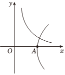

23. （2026•内江） 如图，将反比例函数 $y=\frac{k}{x}$（$k>0$，$x>0$）的图象绕点 $O$ 顺时针旋转 $45^\circ$．旋转后的图象与 $x$ 轴交于点 $A(6, 0)$．则 $k=$ ___ ．

> [!question]- 点击查看答案与解析
> 【答案】$18$
> 
> 【考点】旋转的坐标变换、反比例函数解析式 → [[【初中数学知识点体系-人教版】#27-1 反比例函数]]、[[【初中数学知识点体系-人教版】#28-1 图形的旋转]]
> 
> 【解析】
> 旋转可逆。将 $A(6,0)$ 逆时针旋转 $45^\circ$ 回到原双曲线上的点 $P$：$P(6\cos45^\circ,6\sin45^\circ)=(3\sqrt{3},3\sqrt{3})$。
> $k=x_P y_P=18$。
> 
> 【易错点】注意旋转方向与逆变换对应；双曲线上点的横、纵坐标乘积即为 $k$。
