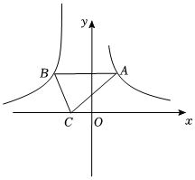

24. （2026•攀枝花） 如图，点 $A$ 在函数 $y=\frac{2}{x}(x>0)$ 的图象上，点 $B$ 在函数 $y=\frac{k}{x}(x<0)$ 的图象上，$AB\parallel x$ 轴，点 $C$ 是 $x$ 轴上一点，若 $\triangle ABC$ 的面积为3，则 $k$ 的值为 ___ ．

> [!question]- 点击查看答案与解析
> 【答案】$-4$
> 
> 【考点】反比例函数与坐标法求三角形面积 → [[【初中数学知识点体系-人教版】#27-1 反比例函数]]、[[【初中数学知识点体系-人教版】#9-2 坐标方法的简单应用]]
> 
> 【解析】
> 设公共纵坐标为 $t>0$，$A\left(\frac{2}{t},t\right)$，$B\left(\frac{k}{t},t\right)$。
> $AB=\frac{2-k}{t}$，$\triangle ABC$ 的高为 $t$，面积 $\frac{1}{2}\cdot\frac{2-k}{t}\cdot t=\frac{1}{2}(2-k)=3$，解得 $k=-4$。
> 
> 【易错点】$B$ 在第二象限，$k<0$；三角形高为纵坐标，面积与 $t$ 无关。
