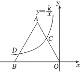

25. （2026•绥化） 如图，反比例函数 $y=\frac{k}{x}$ 与边长为10的等边三角形 $OAB$ 相交于 $C$，$D$ 两点，边 $OB$ 与 $x$ 轴重合，$BD:OC=1:3$，则 $k$ 的值是 ___ ．

> [!question]- 点击查看答案与解析
> 【答案】$-9\sqrt{3}$
> 
> 【考点】等边三角形坐标、比例线段与反比例函数 → [[【初中数学知识点体系-人教版】#27-1 反比例函数]]、[[【初中数学知识点体系-人教版】#9-2 坐标方法的简单应用]]
> 
> 【解析】
> $O(0,0)$，$B(-10,0)$，$A(-5,5\sqrt{3})$。设 $OC=3t$，$BD=t$。
> $C$ 在 $OA$ 上：$C\left(-\frac{3t}{2},\frac{3\sqrt{3}t}{2}\right)$；$D$ 在 $AB$ 上：$D\left(-10+\frac{t}{2},\frac{\sqrt{3}t}{2}\right)$。
> 两点同在双曲线上，横、纵坐标乘积相等，解得 $t=2$，$k=-9\sqrt{3}$。
> 
> 【易错点】先写等边三角形顶点坐标；比例线段分点坐标方向不要写反；第二象限 $k<0$。
