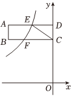

26. （2026•齐齐哈尔） 如图，平面直角坐标系中，矩形 $ABCD$ 的边 $CD$ 在 $y$ 轴正半轴上，$E$ 是边 $AD$ 的中点，$\tan\angle BCE=\frac{2}{3}$，点 $F$ 在边 $BC$ 上，$BF=\frac{1}{3}BC$，反比例函数 $y=\frac{k}{x}$（$x<0$）的图象经过点 $E$，$F$．若 $AD=6$，则 $k$ 的值为 ___ ．

> [!question]- 点击查看答案与解析
> 【答案】$-8$
> 
> 【考点】矩形坐标、锐角三角函数与反比例函数 → [[【初中数学知识点体系-人教版】#27-1 反比例函数]]、[[【初中数学知识点体系-人教版】#9-2 坐标方法的简单应用]]
> 
> 【解析】
> 设 $C(0,c)$、$D(0,d)$，$AD=6$，则 $A(-6,d)$、$B(-6,c)$。$E(-3,d)$，$F\left(-6,\frac{2c+d}{3}\right)$。
> $\tan\angle BCE=\frac{d-c}{3}=\frac{2}{3}$，故 $d-c=2$。
> $E$、$F$ 在同一双曲线上：$-3d=-6\cdot\frac{2c+d}{3}$，得 $d=4c$。联立 $c=\frac{2}{3}$，$d=\frac{8}{3}$，$k=-3d=-8$。
> 
> 【易错点】矩形对边平行；正切为对边比邻边；同一双曲线上横、纵坐标乘积相等。
