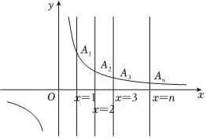

27. （2026•大庆） 如图，在平面直角坐标系中，反比例函数 $y=\frac{2}{x}$ 图象与直线 $x=1$，$x=2$，$x=3$，…，$x=n$（$n\geq 1$ 且 $n$ 为整数）分别交于点 $A_1(x_1, y_1)$，$A_2(x_2, y_2)$，$A_3(x_3, y_3)$，…，$A_n(x_n, y_n)$，则 $y_1y_2+y_2y_3+y_3y_4+\cdots+y_{2025}y_{2026}=$ ___ ．

> [!question]- 点击查看答案与解析
> 【答案】$\frac{4050}{1013}$
> 
> 【考点】反比例函数上点的坐标、裂项求和 → [[【初中数学知识点体系-人教版】#27-1 反比例函数]]
> 
> 【解析】
> $x_i=i$，$y_i=\frac{2}{i}$。$y_i y_{i+1}=\frac{4}{i(i+1)}=4\left(\frac{1}{i}-\frac{1}{i+1}\right)$。
> 裂项求和（$i=1$ 到 $2025$）：$4\left(1-\frac{1}{2026}\right)=\frac{4050}{1013}$。
> 
> 【易错点】裂项前先提取系数 4；末项分母为 $2026$。
