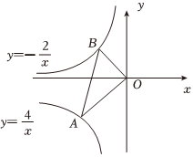

28. （2025•威海） 如图，点 $A$ 在反比例函数 $y=\frac{4}{x}$ 的图象上，点 $B$ 在反比例函数 $y=-\frac{2}{x}$ 的图象上，连接 $OA$，$OB$，$AB$．若 $AO\perp BO$，则 $\tan\angle BAO=$ ___ ．

> [!question]- 点击查看答案与解析
> 【答案】$\frac{\sqrt{2}}{2}$
> 
> 【考点】反比例函数、两直线垂直与直角三角形边角关系 → [[【初中数学知识点体系-人教版】#27-1 反比例函数]]、[[【初中数学知识点体系-人教版】#9-2 坐标方法的简单应用]]
> 
> 【解析】
> 设 $OA=r$，$OB=s$，$OA$ 方向角为 $\theta$。$A$ 在 $y=\frac{4}{x}$ 上：$r^2\sin\theta\cos\theta=4$。
> $OB\perp OA$，$B$ 在 $y=-\frac{2}{x}$ 上：$s^2\sin\theta\cos\theta=2$。两式相除 $\frac{s^2}{r^2}=\frac{1}{2}$。
> Rt$\triangle AOB$ 中 $\tan\angle BAO=\frac{OB}{OA}=\frac{s}{r}=\frac{\sqrt{2}}{2}$。
> 
> 【易错点】垂直时 $B$ 由 $A$ 旋转 $90^\circ$ 得到；所求正切是对边 $OB$ 比邻边 $OA$。
