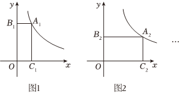

29. （2025•潍坊） 如图1，点 $A_1(x_1, y_1)$ 是函数 $y=\frac{1}{x}(x>0)$ 图象上任意一点，过 $A_1$ 向 $y$ 轴作垂线交 $y$ 轴于点 $B_1$，向 $x$ 轴作垂线交 $x$ 轴于点 $C_1$，矩形 $A_1B_1OC_1$ 的周长 $L_1=2(A_1B_1+A_1C_1)=2(x_1+y_1)=2(x_1+\frac{1}{x_1})$，当 $x_1=\frac{1}{x_1}$ 时，$L_1$ 有最小值4；如图2，点 $A_2(x_2, y_2)$ 是函数 $y=\frac{2}{x}(x>0)$ 图象上任意一点，同样作矩形 $A_2B_2OC_2$，它的周长 $L_2=2(x_2+\frac{2}{x_2})$，同理得 $L_2$ 的最小值为 $4\sqrt{2}$；…；点 $A_n(x_n, y_n)$ 是函数 $y=\frac{n}{x}$（$x>0$，$n$ 为正整数）图象上任意一点，作矩形 $A_nB_nOC_n$，它的周长为 $L_n$，则 $L_n$ 的最小值为 ___ ．

> [!question]- 点击查看答案与解析
> 【答案】$4\sqrt{n}$
> 
> 【考点】反比例函数上点的坐标、最值（均值不等式） → [[【初中数学知识点体系-人教版】#27-1 反比例函数]]
> 
> 【解析】
> $L_n=2\left(x+\frac{n}{x}\right)$。由 $x+\frac{n}{x}\ge 2\sqrt{n}$，当 $x=\sqrt{n}$ 时取等号，故 $L_n$ 的最小值为 $4\sqrt{n}$。
> 
> 【易错点】均值不等式取等条件为 $x=\sqrt{n}$；周长前面还有系数 2。
