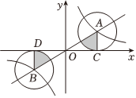

30. （2025•吉林） 如图，在平面直角坐标系中，过原点 $O$ 的直线与反比例函数 $y=\frac{\sqrt{3}}{x}$ 的图象交于 $A$，$B$ 两点，分别以点 $A$，点 $B$ 为圆心，画半径为1的 $\odot A$ 和 $\odot B$．当 $\odot A$，$\odot B$ 分别与 $x$ 轴相切时，切点分别为点 $C$ 和点 $D$，连接 $AC$，$BD$，则阴影部分图形的面积和为 ___ ．（结果保留 $\pi$）

> [!question]- 点击查看答案与解析
> 【答案】$\frac{\pi}{3}$
> 
> 【考点】反比例函数与圆相切、扇形面积 → [[【初中数学知识点体系-人教版】#27-1 反比例函数]]、[[【初中数学知识点体系-人教版】#30-3 弧长和扇形面积]]
> 
> 【解析】
> $\odot A$ 与 $x$ 轴相切，$A$ 的纵坐标为 1，代入 $y=\frac{\sqrt{3}}{x}$ 得 $A(\sqrt{3},1)$，$B(-\sqrt{3},-1)$。
> $OA=2$，半径为 1，$\cos\angle OAC=\frac{1}{2}$，扇形圆心角为 $60^\circ$。
> 两阴影全等，面积和 $=2\cdot\frac{60}{360}\pi\cdot 1^2=\frac{\pi}{3}$。
> 
> 【易错点】相切 ⇒ 圆心到 $x$ 轴的距离等于半径；注意扇形面积公式与两个扇形对称求和。
