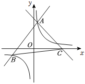

31. （2025•新疆） 如图，在平面直角坐标系中，直线 $y=k_{1}x+b$（$k_{1}\neq 0$）与双曲线 $y=\frac{k_2}{x}$（$k_{2}\neq 0$）交于 $A(1, 4)$，$B(-4, n)$ 两点，过点 $A$ 作直线 $AC\perp AB$ 交 $x$ 轴于点 $C$，连接 $BC$，则 $\triangle ABC$ 的面积是 ___ ．

### 三、解答题（共29小题）

> [!question]- 点击查看答案与解析
> 【答案】$20$
> 
> 【考点】反比例函数与一次函数交点、两直线垂直与坐标法求面积 → [[【初中数学知识点体系-人教版】#27-1 反比例函数]]、[[【初中数学知识点体系-人教版】#23-1 一次函数]]、[[【初中数学知识点体系-人教版】#9-2 坐标方法的简单应用]]
> 
> 【解析】
> 双曲线 $k_2=1\times4=4$，$B(-4,-1)$。直线 $AB$ 斜率为 1，$y=x+3$。
> $AC\perp AB$，斜率为 $-1$，$y=-x+5$，交 $x$ 轴于 $C(5,0)$。
> $AB=5\sqrt{2}$，$AC=4\sqrt{2}$，$S_{\triangle ABC}=\frac{1}{2}\cdot5\sqrt{2}\cdot4\sqrt{2}=20$。
> 
> 【易错点】垂直两直线斜率乘积为 $-1$；直角三角形面积用两直角边乘积的一半。
