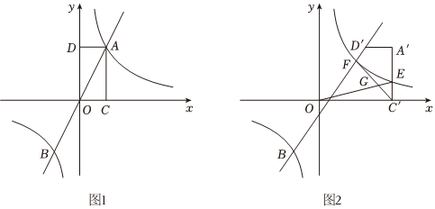

32. （2026•成都） 如图1，在平面直角坐标系 $xOy$ 中，直线 $y=kx$ 与反比例函数 $y=\frac{2}{x}$ 的图象相交于 $A(1, a)$，$B$ 两点，过点 $A$ 分别作 $x$ 轴，$y$ 轴的垂线，垂足分别为 $C$，$D$．
（1）求线段 $AB$ 的长；
（2）已知 $P$ 为 $y$ 轴正半轴上一点，若 $\triangle ABP$ 为直角三角形，求点 $P$ 的坐标；
（3）如图2，将线段 $DA$，$AC$ 组成的折线段“$D-A-C$”沿 $x$ 轴正方向平移得到折线段“$D'-A'-C'$”，点 $D$，$A$，$C$ 的对应点分别为 $D'$，$A'$，$C'$．$A'C'$ 与反比例函数的图象交于点 $E$，直线 $BD'$ 与反比例函数的图象在第一象限交于点 $F$，$OE$ 与 $C'F$ 交于点 $G$．试探究：在平移过程中，$\frac{FG}{GC'}$ 的值是否为定值？若是，求出这个值；若不是，请说明理由．

> [!question]- 点击查看答案与解析
> 【答案】（1）$AB=2\sqrt5$；（2）$P(0,\frac52)$ 或 $P(0,\sqrt5)$；（3）是定值，$\frac{FG}{GC'}=\frac32$
> 
> 【考点】待定系数法求交点、勾股定理求线段长、直角三角形分类讨论、平移与定值探究 → [[【初中数学知识点体系-人教版】#27-1 反比例函数]]、[[【初中数学知识点体系-人教版】#23-1 一次函数]]、[[【初中数学知识点体系-人教版】#7-4 平移]]、[[【初中数学知识点体系-人教版】#20-1 勾股定理]]
> 
> 【解析】
> （1）$A(1,a)$ 在 $y=\frac2x$ 上，$a=2$，故 $A(1,2)$；直线 $y=kx$ 过 $A$，$k=2$。双曲线与过原点的直线关于原点对称，$B(-1,-2)$。
> $AB=\sqrt{(1+1)^2+(2+2)^2}=2\sqrt5$。
> （2）设 $P(0,p)$（$p>0$）。$AB^2=20$，$AP^2=1+(p-2)^2$，$BP^2=1+(p+2)^2$。
> 直角顶点在 $P$：$\overrightarrow{PA}\cdot\overrightarrow{PB}=0$，$-1+(2-p)(-2-p)=0$，$p^2=5$，$p=\sqrt5$；
> 直角顶点在 $A$：$\overrightarrow{AB}\cdot\overrightarrow{AP}=0$，$2-4(p-2)=0$，$p=\frac52$；
> 直角顶点在 $B$：解得 $p=-\frac52$，不合 $p>0$，舍去。故 $P(0,\sqrt5)$ 或 $P(0,\frac52)$。
> （3）设平移后 $A'(a,2)$，则 $D'(a-1,2)$，$C'(a,0)$。$A'C'$ 交双曲线于 $E(a,\frac2a)$。
> 直线 $BD'$ 过 $B(-1,-2)$、$D'(a-1,2)$，斜率 $\frac4a$，与 $y=\frac2x$ 联立得 $2x^2+(2-a)x-a=0$，根为 $x=-1$（点 $B$）与 $x=\frac a2$，故 $F(\frac a2,\frac4a)$。
> 直线 $OE$：$y=\frac{2}{a^2}x$；直线 $C'F$：$y=-\frac{8}{a^2}(x-a)$。联立解得 $G(\frac{4a}{5},\frac{8}{5a})$。
> 在直线 $C'F$ 上，由横坐标知 $G$ 分 $FC'$ 的比 $FG:GC'=3:2$，故 $\frac{FG}{GC'}=\frac32$，为定值。
> 
> 【易错点】直角三角形须按直角顶点分三类讨论并舍去负半轴解；定值探究中平移量 $a$ 最终在比值里约去，注意交点联立后要舍去对应已知点 $B$ 的根。
