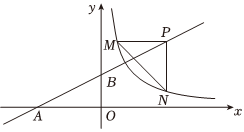

33. （2026•苏州） 如图，一次函数 $y=ax+b$ 的图象经过点 $A(-4, 0)$，$B(0, 2)$，点 $P$ 在一次函数的图象上，过点 $P$ 分别作 $x$ 轴和 $y$ 轴的平行线交反比例函数 $y=\frac{k}{x}(k>0, x>0)$ 的图象于 $M$，$N$ 两点，连接 $MN$．
（1）求 $a$，$b$ 的值；
（2）若 $\triangle PMN$ 是腰长为 3 的等腰直角三角形，求点 $P$ 的坐标和 $k$ 的值．

> [!question]- 点击查看答案与解析
> 【答案】（1）$a=\frac{1}{2}$，$b=2$；（2）$P(4,4)$，$k=4$
> 
> 【考点】待定系数法、等腰直角三角形与反比例函数上点的坐标 → [[【初中数学知识点体系-人教版】#27-1 反比例函数]]、[[【初中数学知识点体系-人教版】#23-1 一次函数]]、[[【初中数学知识点体系-人教版】#9-2 坐标方法的简单应用]]
> 
> 【解析】
> （1）直线过 $A(-4,0)$、$B(0,2)$，斜率 $\frac{1}{2}$，$a=\frac{1}{2}$，$b=2$，$y=\frac{1}{2}x+2$。
> （2）设 $P(p,\frac{p}{2}+2)$。$PM$ 水平、$PN$ 竖直，$\triangle PMN$ 直角顶点在 $P$；等腰直角且腰长为 3，故 $PM=PN=3$。
> $M\left(\frac{k}{y_P},y_P\right)$，$N\left(p,\frac{k}{p}\right)$，由 $p-\frac{k}{y_P}=3$ 与 $y_P-\frac{k}{p}=3$ 推得 $y_P=p$，即 $\frac{p}{2}+2=p$，$p=4$，$P(4,4)$，$k=4$。
> 
> 【易错点】水平、竖直连线构成直角；等腰直角两腰相等，分别用横坐标差、纵坐标差表示。
